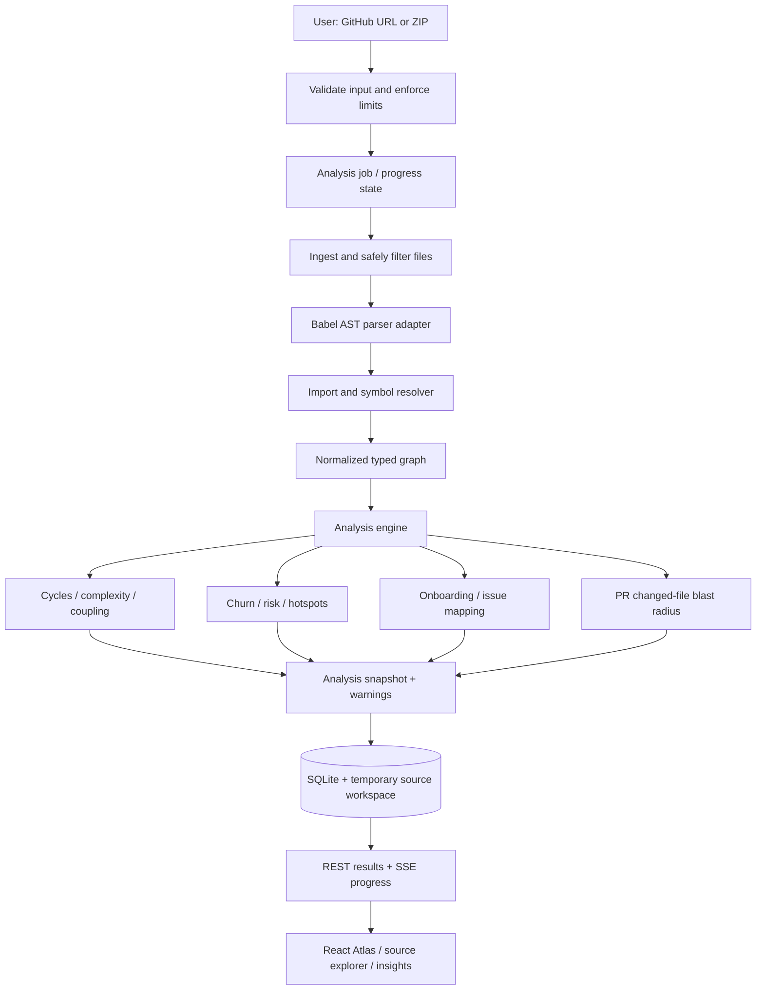

# CodeDarpan — Final Project Implementation Checklist

**Version:** 1.0  

**Prepared:** 20 October 2026  

**Project name:** CodeDarpan  
**Tagline:** Understand the code behind the code.  
**Purpose:** The single build source of truth for a three-person, intermediate-level team, including implementation decisions, file inventory, tasks, acceptance tests, delivery requirements and checklists.

## Build decision — follow this plan

Build a **TypeScript modular monolith** with a React/Vite frontend, Express API, Babel-based JavaScript/TypeScript analysis, Cytoscape.js graph, SQLite persistence and a single normalized graph contract shared by frontend and backend. Do not build the parser twice, introduce a graph database, or start with 3D/AI.

**Build sequence:** shared contract and fixture → safe GitHub/ZIP ingestion → file index → AST facts → import resolver → normalized graph and algorithms → API/persistence/job progress → real graph UI → source viewer/search/metrics → full Victory-tier analytics → tests/benchmarks/docs/deployment/demo.

**Important status rule:** no application source repository or executed test evidence was provided in the supplied archive. Therefore, every checklist below starts **NOT STARTED**. Nothing is already implemented or verified based only on the planning PDFs.

## Priority legend

- **P0 / MVP-required:** required for the first genuine end-to-end workflow and Foundation-tier compliance.
- **P1 / full-PS-required:** required for the official Victory tier and the complete requested deliverable; begin only after P0 works end to end.
- **P2 / optional:** only after all R01-R25 acceptance tests pass.
- **Test/Deploy:** required to validate, reproduce, deploy or demonstrate honestly.

## First milestone — non-negotiable exit gate

The first milestone is complete only when a real public GitHub URL or real ZIP produces a genuine API analysis result; that result renders as an interactive graph; selecting a node opens its matching source and dependencies; token count/complexity are shown with documented conventions; searching finds and centers a matching node; and an automated end-to-end test passes without hardcoded production data.

---

# 1. Requirement Traceability Register

**Use this table as the implementation contract.** `M` means an explicit Problem Statement requirement and `E` means a bonus target. All R01-R25 items are in scope for the complete product. Foundation features are the first milestone; Victory-tier features remain mandatory for claiming full PS completion. Every item starts as `NOT STARTED` until its acceptance test passes.

### R01 — PS, Foundation; M
**ID:** R01

**Source / class:** PS, Foundation; M

**Requirement and interpretation:** Accept public GitHub repository URLs. Validate owner/repo and any optional ref; pin the analyzed revision when possible.

**Input → expected output:** URL/ref → analysis job, revision metadata, result or clear error

**Dependencies:** URL validation, GitHub downloader

**Objective verification:** Analyze a known public repo; assert recorded revision and expected files. Reject malformed/non-GitHub URLs.

**Priority / failure impact:** Critical; no URL ingestion undermines the core workflow.

### R02 — PS, Foundation; M
**ID:** R02

**Source / class:** PS, Foundation; M

**Requirement and interpretation:** Accept ZIP archives. Extract safely and make source tree available to the same analysis pipeline.

**Input → expected output:** ZIP → indexed repository or structured rejection

**Dependencies:** Upload handling, archive limits, safe extraction

**Objective verification:** Upload a valid fixture ZIP and compare indexed paths; test path-traversal and oversized archives.

**Priority / failure impact:** Critical; missing ZIP upload leaves an explicit foundation gap.

### R03 — PS, Foundation; M
**ID:** R03

**Source / class:** PS, Foundation; M

**Requirement and interpretation:** Parse directory trees and source files into an indexed structure. Track supported, ignored, skipped, and failed files.

**Input → expected output:** File tree/source → file index, language, path, warnings

**Dependencies:** R01/R02, filters

**Objective verification:** Fixture tree yields exact expected file list and scan/skip/error counts.

**Priority / failure impact:** Critical; otherwise graph/search cannot be trusted.

### R04 — PS, Foundation; M
**ID:** R04

**Source / class:** PS, Foundation; M

**Requirement and interpretation:** Render an interactive 2D/3D topological dependency atlas of files, functions, and architecture. Use at least one force-directed or hierarchical layout.

**Input → expected output:** Normalized graph → selectable, pannable, zoomable graph

**Dependencies:** R03, R05, frontend graph

**Objective verification:** Load a graph fixture; assert nodes/edges appear and pan/zoom/select work.

**Priority / failure impact:** Critical; a static picture is not sufficient.

### R05 — PS, Foundation; M
**ID:** R05

**Source / class:** PS, Foundation; M

**Requirement and interpretation:** Show module imports and file linkages as distinct relationships, not arbitrary lines.

**Input → expected output:** Parsed imports → typed directed edges

**Dependencies:** AST, resolver, graph contract

**Objective verification:** Fixture with known imports yields exact edge endpoints, types, and direction.

**Priority / failure impact:** Critical; false edges undermine credibility.

### R06 — PS, Foundation; M
**ID:** R06

**Source / class:** PS, Foundation; M

**Requirement and interpretation:** Visualize architectural clusters.

**Input → expected output:** Graph/modules → visible groupings or clusters

**Dependencies:** Graph grouping and UI legend

**Objective verification:** Fixture with known folders/modules displays labelled groups and can be expanded/filtered.

**Priority / failure impact:** High; without it, larger graphs become hard to interpret.

### R07 — PS, Foundation; M
**ID:** R07

**Source / class:** PS, Foundation; M

**Requirement and interpretation:** Provide a side-by-side code exploration panel displaying file contents.

**Input → expected output:** Selected node/file → matching source content

**Dependencies:** File index, source retrieval, graph selection

**Objective verification:** Click a node and assert the displayed path and source match the fixture byte-for-byte apart from rendering.

**Priority / failure impact:** Critical; the atlas needs inspectable evidence.

### R08 — PS, Foundation; M
**ID:** R08

**Source / class:** PS, Foundation; M

**Requirement and interpretation:** Display source token counts. Define the counting convention; do not confuse tokens with characters or lines.

**Input → expected output:** Source text → integer token count + method label

**Dependencies:** Lexer/parser

**Objective verification:** Use fixed snippets with known lexical tokens; compare exact results.

**Priority / failure impact:** High; explicit PS field is missing if omitted.

### R09 — PS, Foundation; M
**ID:** R09

**Source / class:** PS, Foundation; M

**Requirement and interpretation:** Calculate and display cyclomatic complexity where supported.

**Input → expected output:** AST/function → estimated complexity and supported/unsupported label

**Dependencies:** AST traversal, metric convention

**Objective verification:** Known branch fixtures match documented expected numbers.

**Priority / failure impact:** High; explicit PS field and core health signal.

### R10 — PS, Foundation; M
**ID:** R10

**Source / class:** PS, Foundation; M

**Requirement and interpretation:** Display import dependencies for the selected file/symbol.

**Input → expected output:** Selected node → incoming/outgoing import dependencies

**Dependencies:** R05 and graph direction convention

**Objective verification:** On a fixture, inspector lists exact imported and dependent files.

**Priority / failure impact:** Critical; false or missing dependencies break the primary journey.

### R11 — PS, Foundation; M
**ID:** R11

**Source / class:** PS, Foundation; M

**Requirement and interpretation:** Search and filter symbols, functions, and files.

**Input → expected output:** Query/filter → matching indexed entities

**Dependencies:** Symbol index, file index

**Objective verification:** Exact, partial, empty, ambiguous, and unsupported queries return expected results.

**Priority / failure impact:** Critical; explicit foundation feature.

### R12 — PS, Foundation; M
**ID:** R12

**Source / class:** PS, Foundation; M

**Requirement and interpretation:** Search should center the graph on the matching entity and visually highlight dependencies.

**Input → expected output:** Selected search result → centered node and highlighted paths

**Dependencies:** R04/R11, graph interaction state

**Objective verification:** E2E test searches a fixture symbol; assert node selection, centering request, and incoming/outgoing highlighting.

**Priority / failure impact:** High; otherwise search is disconnected from the atlas.

### R13 — PS, Victory Tier; M
**ID:** R13

**Source / class:** PS, Victory Tier; M

**Requirement and interpretation:** Perform deep AST parsing with Tree-sitter/Babel or an appropriate language AST parser.

**Input → expected output:** Source → syntax nodes, symbols, source spans, parse diagnostics

**Dependencies:** R03, parser adapter

**Objective verification:** Parse JS/TS fixtures covering functions, classes, imports, exports, JSX/TS syntax, and malformed files.

**Priority / failure impact:** High; regex-only parsing is not sufficient.

### R14 — PS, Victory Tier; M
**ID:** R14

**Source / class:** PS, Victory Tier; M

**Requirement and interpretation:** Map call graphs and function dependencies where statically resolvable.

**Input → expected output:** Function definitions/calls → typed call edges with resolution status

**Dependencies:** R13, symbol/import resolution

**Objective verification:** Fixture with imported and local calls produces known resolved edges; dynamic call remains unresolved.

**Priority / failure impact:** High; no call relationships means advanced AST scope is incomplete.

### R15 — PS, Victory Tier; M
**ID:** R15

**Source / class:** PS, Victory Tier; M

**Requirement and interpretation:** Identify circular import cycles.

**Input → expected output:** Directed import graph → cycle groups and self-loops

**Dependencies:** R05, graph algorithm

**Objective verification:** Fixture A→B→A reports one cycle; acyclic graph reports none; self-loop is covered.

**Priority / failure impact:** High; explicit advanced criterion.

### R16 — PS, Victory Tier; M
**ID:** R16

**Source / class:** PS, Victory Tier; M

**Requirement and interpretation:** Build code-churn-versus-complexity heatmaps. Churn requires accessible Git history; ZIP-only runs must report unavailable history.

**Input → expected output:** Git history + complexity → per-file churn and heatmap/availability state

**Dependencies:** R01, history ingestion, R09

**Objective verification:** For a known commit fixture, added/deleted line counts match expected values; ZIP-only run says unavailable, not zero.

**Priority / failure impact:** High; false zero churn is misleading.

### R17 — PS, Victory Tier; M
**ID:** R17

**Source / class:** PS, Victory Tier; M

**Requirement and interpretation:** Highlight fragile high-risk “god files” and technical-debt hotspots. Findings must cite evidence, not just color a node.

**Input → expected output:** Structural metrics → candidate hotspots with reasons

**Dependencies:** R09, R15, graph metrics, optional R16

**Objective verification:** Synthetic hotspot fixture ranks the intended files and exposes the contributing metrics/thresholds.

**Priority / failure impact:** High; opaque labels are hard to defend.

### R18 — PS, Victory Tier; M
**ID:** R18

**Source / class:** PS, Victory Tier; M

**Requirement and interpretation:** Compute architectural health scoring with transparent, inspectable factors.

**Input → expected output:** Normalized metrics → score, evidence, confidence, missing-signal handling

**Dependencies:** R09, R15–R17

**Objective verification:** Unit tests verify normalization, weights, missing-data behavior, and evidence drill-down.

**Priority / failure impact:** High; arbitrary/unexplained scores invite judge challenges.

### R19 — PS, Victory Tier; M
**ID:** R19

**Source / class:** PS, Victory Tier; M

**Requirement and interpretation:** Recommend contributor onboarding pathways, including a reasoned sequence through files/modules.

**Input → expected output:** Repository/role/task → ordered file path with reason per step

**Dependencies:** Graph, symbols, documentation/test signals

**Objective verification:** Fixture with known entry point and relevant/low-complexity modules yields a valid path and explanations.

**Priority / failure impact:** High; a flat, unexplained list is weaker than a pathfinder.

### R20 — PS, Victory Tier; M
**ID:** R20

**Source / class:** PS, Victory Tier; M

**Requirement and interpretation:** Link good-first-issue/help-wanted issues to likely files using explainable evidence where issues are available.

**Input → expected output:** Public issue/labels/text → candidate files and route

**Dependencies:** GitHub issues integration, search, graph

**Objective verification:** Fixture issue mentioning a known module maps to it with cited string/graph evidence; API failure is surfaced.

**Priority / failure impact:** High; a generic tour alone does not fully cover the poster wording.

### R21 — PS, Victory Tier; M
**ID:** R21

**Source / class:** PS, Victory Tier; M

**Requirement and interpretation:** Estimate file-change blast radius for newcomer pull requests. Use changed files from a public PR and graph reverse traversal to show likely downstream impact and tests.

**Input → expected output:** Public PR URL → changed files, direct/transitive dependents, related tests, uncertainty

**Dependencies:** GitHub PR files API, graph, impact traversal

**Objective verification:** Known public/synthetic PR fixture produces expected changed-file set and dependent closure; unsupported/private PR shows a clear limitation.

**Priority / failure impact:** High; generic “impact by clicked file” alone is only partial.

### R22 — PS, Deliverables; M
**ID:** R22

**Source / class:** PS, Deliverables; M

**Requirement and interpretation:** Deliver a GitHub repository containing the application and a modular parsing pipeline.

**Input → expected output:** Source repository → reproducible project build

**Dependencies:** All modules, build scripts

**Objective verification:** Fresh clone followed by documented install/test/run succeeds.

**Priority / failure impact:** Critical; missing source repo means the deliverable is absent.

### R23 — PS, Deliverables; M
**ID:** R23

**Source / class:** PS, Deliverables; M

**Requirement and interpretation:** README must explain AST traversal algorithms and graph-rendering optimizations.

**Input → expected output:** Implementation → documented, reproducible methodology

**Dependencies:** Parser/graph implementation

**Objective verification:** Reviewer can trace docs to actual code and execute described tests/commands.

**Priority / failure impact:** High; weak documentation harms technical review.

### R24 — PS, Deliverables; M
**ID:** R24

**Source / class:** PS, Deliverables; M

**Requirement and interpretation:** Disclose tools used. Include libraries, licenses, APIs, and any AI models/tools and their roles.

**Input → expected output:** Dependency/tool inventory → disclosure section

**Dependencies:** Package manifests, project choices

**Objective verification:** Every production dependency and used external/model tool appears in the disclosure.

**Priority / failure impact:** High; a required deliverable.

### R25 — PS, Deliverables; M
**ID:** R25

**Source / class:** PS, Deliverables; M

**Requirement and interpretation:** Produce a large-repository benchmarking report. Include method and actual results.

**Input → expected output:** Reproducible datasets/env → files/nodes/edges/timings/render metrics

**Dependencies:** Benchmark harness, stable pipeline

**Objective verification:** Another teammate reruns a documented benchmark and reproduces reported counters/measurements within stated tolerance.

**Priority / failure impact:** High; template-only or invented numbers do not comply.

### E01 — PS, Technical Freedom; E
**ID:** E01

**Source / class:** PS, Technical Freedom; E

**Requirement and interpretation:** Bonus target: repository parsing under five seconds. Define exactly what “parsing” means and report download/analysis/render time separately.

**Input → expected output:** Fixed benchmark repository → measured parse duration

**Dependencies:** R25, test environment

**Objective verification:** Repeated cold/warm runs with commit, sizes, hardware, median and spread reported; target is met only if measured.

**Priority / failure impact:** Bonus; never claim without evidence.

### E02 — PS, Technical Freedom; E
**ID:** E02

**Source / class:** PS, Technical Freedom; E

**Requirement and interpretation:** Bonus target: 60 FPS graph physics on 500+ nodes. Interactive graph must be real, not a static mock.

**Input → expected output:** 500+ node/edge graph → measured frame/interaction behavior

**Dependencies:** R04/R06, benchmark harness

**Objective verification:** Repeatable browser profiling records node/edge counts and frame-time/FPS measurements on a specified machine.

**Priority / failure impact:** Bonus; may differentiate the product but cannot displace core correctness.


## Implementation assumptions to record

1. **Parser and language scope:** implement Babel for JavaScript, JSX, TypeScript and TSX first. Label other languages unsupported in v1; add another parser only after the JS/TS pipeline passes.
2. **Issue/PR scope:** implement public GitHub issue discovery and public PR URL analysis, with issue-to-file evidence and PR changed-file blast-radius estimates. If the API is unavailable, show a clear limitation rather than a fake success.
3. **Parsing performance:** measure parser-only time and end-to-end time separately. Treat the under-five-second target as a bonus that must be measured, not promised.
4. **Schedule:** the roadmap's 10 focused working days are a planning assumption because no official deadline was supplied. Adjust estimates when the actual deadline is known; do not cut mandatory tests to meet an arbitrary schedule.

---

# 2. Final Product Definition and Prioritized Scope

## Product promise

**CodeDarpan turns a public repository or ZIP into an evidence-backed, interactive architecture map, explains structural risk, estimates the blast radius of a change, and guides a newcomer toward relevant files and tests.**

## Product modes

1. **Explore:** file tree, graph, search, source code, import/call relationships, token count and complexity.
2. **Diagnose:** cycles, complexity/coupling/churn heatmap, candidate god files, transparent health score and evidence.
3. **Plan:** selected file/symbol impact, public PR changed files, reverse dependencies and likely related tests.
4. **Onboard:** choose an issue/task type or contributor role; receive a sequenced path with a reason for each step.

## Priority definitions

- **P0 — Foundation / first vertical slice:** required to make a real product usable. These are the Foundation-tier items; they are not enough by themselves to claim full advanced-scope compliance.
- **P1 — Victory-tier completion:** required before claiming the full official PS has been completed. Build only after the P0 vertical slice works, but do not reclassify them as optional.
- **P2 — Optional polish:** only after all P0/P1 acceptance tests pass.

### F01 — Public GitHub URL + ZIP intake, limits, progress and clear failures
**Feature ID:** F01

**Feature:** Public GitHub URL + ZIP intake, limits, progress and clear failures

**Priority:** P0

**Requirements:** R01–R03

**Implementation approach:** One analysis-job API; GitHub archive retrieval; safe streamed ZIP extraction; file filter

**Dependencies:** URL/archive validators

**Effort assumption:** 1–2 developer-days

**Acceptance condition:** Both inputs produce the same normalized file-index format; unsafe input is rejected.

### F02 — JS/TS AST index and normalized graph
**Feature ID:** F02

**Feature:** JS/TS AST index and normalized graph

**Priority:** P0

**Requirements:** R03, R05, R13

**Implementation approach:** Babel AST adapter, import/export/symbol extraction, custom resolver, edge confidence

**Dependencies:** F01, shared contracts

**Effort assumption:** 2–3 developer-days

**Acceptance condition:** Known fixture yields expected nodes, imports and source ranges.

### F03 — Interactive atlas and code explorer
**Feature ID:** F03

**Feature:** Interactive atlas and code explorer

**Priority:** P0

**Requirements:** R04–R10

**Implementation approach:** Cytoscape.js canvas, file tree, inspector, code highlighter, token/complexity/import metrics

**Dependencies:** F02

**Effort assumption:** 2–3 developer-days

**Acceptance condition:** Select/search graph node and see exact source and metrics.

### F04 — Search/filter with centering and highlighted relationships
**Feature ID:** F04

**Feature:** Search/filter with centering and highlighted relationships

**Priority:** P0

**Requirements:** R11–R12

**Implementation approach:** Search index, graph selection and neighborhood highlighting

**Dependencies:** F02–F03

**Effort assumption:** 1 developer-day

**Acceptance condition:** Search and filter tests pass without rebuilding/re-fetching entire analysis.

### F05 — Cycles and explainable health/risk findings
**Feature ID:** F05

**Feature:** Cycles and explainable health/risk findings

**Priority:** P1

**Requirements:** R15, R17–R18

**Implementation approach:** Tarjan SCC, structural metrics, transparent normalized score, factor panel

**Dependencies:** F02; F03 can display

**Effort assumption:** 1–2 developer-days

**Acceptance condition:** Test fixtures detect cycle/hotspot and UI exposes rule/metric evidence.

### F06 — Git history churn and complexity heatmap
**Feature ID:** F06

**Feature:** Git history churn and complexity heatmap

**Priority:** P1

**Requirements:** R16–R18

**Implementation approach:** Bounded GitHub history acquisition; added/deleted lines per file; heatmap; unavailable state

**Dependencies:** F01, F02, GitHub integration

**Effort assumption:** 2–3 developer-days

**Acceptance condition:** Known-history fixture yields expected churn; ZIP-only run states history unavailable.

### F07 — Function-call relationships
**Feature ID:** F07

**Feature:** Function-call relationships

**Priority:** P1

**Requirements:** R14

**Implementation approach:** Extract statically resolvable local/imported call sites; preserve confidence

**Dependencies:** F02

**Effort assumption:** 1–3 developer-days

**Acceptance condition:** Known calls resolve; dynamic/ambiguous calls are marked unresolved.

### F08 — Contributor path and issue-to-file association
**Feature ID:** F08

**Feature:** Contributor path and issue-to-file association

**Priority:** P1

**Requirements:** R19–R20

**Implementation approach:** Deterministic scoring from README, entry points, symbol/file mentions, tests and graph

**Dependencies:** F02, F06 optional

**Effort assumption:** 1–2 developer-days

**Acceptance condition:** Each path step contains evidence and a useful next file; issue API failure is visible.

### F09 — Public PR blast-radius analysis
**Feature ID:** F09

**Feature:** Public PR blast-radius analysis

**Priority:** P1

**Requirements:** R21

**Implementation approach:** Parse PR URL, fetch changed-file list, map files to graph nodes, reverse BFS, show tests/unknowns

**Dependencies:** F02, GitHub client

**Effort assumption:** 1–2 developer-days

**Acceptance condition:** Known PR changed files and dependency closure match test fixture.

### F10 — Tests, actual large-graph benchmark, README, tool disclosure
**Feature ID:** F10

**Feature:** Tests, actual large-graph benchmark, README, tool disclosure

**Priority:** P0/P1 gate

**Requirements:** R22–R25, E01–E02

**Implementation approach:** Vitest/HTTP/E2E tests, stress graph, reproducible timing script, docs

**Dependencies:** F01–F09 as applicable

**Effort assumption:** 2 developer-days spread across project

**Acceptance condition:** Fresh clone works; all R acceptance tests have a recorded outcome; report contains measured data.

### F11 — Optional 3D view
**Feature ID:** F11

**Feature:** Optional 3D view

**Priority:** P2

**Requirements:** Optional extension to R04

**Implementation approach:** Three.js only if 2D graph is stable

**Dependencies:** F03, E02

**Effort assumption:** Unbounded until core complete

**Acceptance condition:** Never begins until all mandatory tests pass.

### F12 — Natural-language AI explanations
**Feature ID:** F12

**Feature:** Natural-language AI explanations

**Priority:** P2

**Requirements:** No explicit PS requirement

**Implementation approach:** Optional model summarizes already-computed evidence; disclose provider/data usage

**Dependencies:** F05/F08

**Effort assumption:** Depends on API and budget

**Acceptance condition:** Can be removed without breaking core functions; output never invents graph facts.


## Features to deliberately reject early

- Full IDE/edit-and-run environment.
- AI agent that modifies code or claims to predict all runtime failures.
- Universal multi-language support in v1.
- Login, collaboration, teams, comments, or cloud-scale tenancy unless specifically required by organizers.
- Microservices, Kubernetes, Kafka, Redis, vector database, or graph database without measured need.
- 3D-first interface, decorative animation system, or elaborate landing page before the graph works.
- Fake data shown as if generated from a user's live repository.

---

# 3. Technology Stack, Architecture, and System Flow

## Recommended stack

### Frontend — React + TypeScript + Vite
**Layer:** Frontend

**Decision:** React + TypeScript + Vite

**Why:** Quick SPA development; shared types; no SSR requirement apparent in the PS

**Trade-off / alternative:** Next.js is also feasible, but SSR is not a core need here

**MVP?:** Yes

### UI styling — Tailwind CSS; add only selected shadcn/ui components
**Layer:** UI styling

**Decision:** Tailwind CSS; add only selected shadcn/ui components

**Why:** Reuse common controls and maintain consistent visual language

**Trade-off / alternative:** A component library can introduce styling work; use selectively

**MVP?:** Yes, lean version

### Graph — Cytoscape.js; add `cytoscape-dagre` only if implementing hierarchical layout
**Layer:** Graph

**Decision:** Cytoscape.js; add `cytoscape-dagre` only if implementing hierarchical layout

**Why:** Graph-native interaction and layout support; useful performance controls exist in its docs

**Trade-off / alternative:** D3/React Flow/Three.js are alternatives; do not use two graph engines

**MVP?:** Yes

### Code panel — Shiki or lightweight read-only syntax highlighter with line numbers
**Layer:** Code panel

**Decision:** Shiki or lightweight read-only syntax highlighter with line numbers

**Why:** Code inspection is needed, full IDE editing is not

**Trade-off / alternative:** Monaco adds weight and should be optional

**MVP?:** Yes

### Backend — Node.js + TypeScript + Express (modular monolith)
**Layer:** Backend

**Decision:** Node.js + TypeScript + Express (modular monolith)

**Why:** One main language; simple REST and SSE; familiar request/response contract

**Trade-off / alternative:** FastAPI/Python is reasonable if the team is materially stronger in Python

**MVP?:** Yes

### Parser — `@babel/parser` + `@babel/traverse` for JS/JSX/TS/TSX
**Layer:** Parser

**Decision:** `@babel/parser` + `@babel/traverse` for JS/JSX/TS/TSX

**Why:** The official PS names Babel as an option; the parser supports JSX and TypeScript syntax and can provide source locations/tokens

**Trade-off / alternative:** Babel syntax trees alone do not prove exact runtime call targets; unresolved links must remain unresolved

**MVP?:** Yes

### Graph algorithms — Typed adjacency lists + Tarjan SCC + BFS
**Layer:** Graph algorithms

**Decision:** Typed adjacency lists + Tarjan SCC + BFS

**Why:** One graph definition can support cycles, neighborhood highlight, impact and onboarding

**Trade-off / alternative:** A graph library is fine but must not create a second source of truth

**MVP?:** Yes

### Persistence — SQLite for analysis metadata, normalized nodes/edges, metrics and findings
**Layer:** Persistence

**Decision:** SQLite for analysis metadata, normalized nodes/edges, metrics and findings

**Why:** Simple local/reproducible prototype; no graph database needed

**Trade-off / alternative:** PostgreSQL only if deployment/multi-user needs demand it

**MVP?:** Yes, small

### Analysis progress — SSE endpoint per analysis job
**Layer:** Analysis progress

**Decision:** SSE endpoint per analysis job

**Why:** Simple server-to-client progress stream

**Trade-off / alternative:** Polling can be used as fallback

**MVP?:** Yes

### GitHub integration — Public GitHub archive/issues/PR APIs; optional `GITHUB_TOKEN` for higher rate limits
**Layer:** GitHub integration

**Decision:** Public GitHub archive/issues/PR APIs; optional `GITHUB_TOKEN` for higher rate limits

**Why:** Covers public URL, issue association, public PR changed files, and revision metadata

**Trade-off / alternative:** Network/rate limits can delay the demo; provide cached/local fixture fallback with explicit label

**MVP?:** Yes for public workflows

### Tests — Vitest + Supertest (and Playwright if time permits)
**Layer:** Tests

**Decision:** Vitest + Supertest (and Playwright if time permits)

**Why:** One TS-native unit/integration test flow

**Trade-off / alternative:** Browser E2E is essential for final workflow but can start with one high-value scenario

**MVP?:** Yes

### Deployment — Single Node API plus built frontend on one host; local SQLite/temp workspace
**Layer:** Deployment

**Decision:** Single Node API plus built frontend on one host; local SQLite/temp workspace

**Why:** Low operational complexity

**Trade-off / alternative:** Use a persistent volume for SQLite if the host's filesystem is ephemeral

**MVP?:** Yes

### AI/ML — None required for the core. Optional explanation model only after acceptance tests.
**Layer:** AI/ML

**Decision:** None required for the core. Optional explanation model only after acceptance tests.

**Why:** Structural claims must come from deterministic analysis

**Trade-off / alternative:** AI increases privacy/cost/latency and can hallucinate

**MVP?:** No


### Technical corroboration

- Babel's official parser documentation describes JSX and TypeScript plugin support, source locations, tokens, and error-recovery options: https://babeljs.io/docs/babel-parser
- Cytoscape.js documents force-directed layouts and performance considerations/optimization knobs for larger graphs: https://js.cytoscape.org/ . Do not infer 60 FPS from using the library; measure it.
- GitHub's REST API documents public pull-request endpoints, including listing files in a PR, along with response limits: https://docs.github.com/en/rest/pulls/pulls . Keep PR ingestion bounded and handle rate limits.
- Node's worker-thread documentation describes workers as useful for CPU-intensive JavaScript work: https://nodejs.org/api/worker_threads.html . Use a worker/isolated job runner if analysis blocks API progress; otherwise keep the initial workload bounded and test responsiveness.

## System architecture diagram



## Analysis states

`queued → validating → ingesting → filtering → parsing → resolving → analyzing → ready`

Any active state may become `cancelled` or `failed`. Each stage must write a timestamp/duration and a structured warning or error. The API must return a job ID promptly; the UI must not freeze while analysis runs.

## Data flow, including fallbacks

1. **Intake:** Validate a public GitHub URL or accept a bounded ZIP stream. Reject unsupported schemes/hosts and malformed URLs.
2. **Retrieve:** For a GitHub URL, resolve a branch/tag/commit and record the commit SHA. For a ZIP, record filename/hash and note that Git history may be unavailable.
3. **Filter:** Ignore `.git`, `node_modules`, `vendor`, build outputs, binary files, generated bundles, `.env` and obvious secret files; enforce per-file/archive/file-count/time limits.
4. **Parse:** Babel parses supported `.js`, `.jsx`, `.ts`, and `.tsx` sources. Continue after recoverable parse errors, but label skipped or partially parsed files.
5. **Extract:** Build file/module/function/class/symbol nodes, source ranges, imports/exports, calls where resolvable, token count and complexity signals.
6. **Resolve:** Resolve relative paths, extensions, index files, configured aliases, barrel re-exports, and known package boundaries. Keep dynamic or ambiguous references unresolved/possible rather than inventing an edge.
7. **Normalize:** Build one node/edge schema for all frontend views. Avoid separate graph semantics in UI and backend.
8. **Analyze:** Build graph adjacency; compute SCC cycles, fan-in/out, complexity, code churn when history exists, risk factors, issue/file matches, onboarding paths and PR impact.
9. **Persist:** Store analysis metadata, normalized graph, findings, warnings and benchmark timing. Store source files only in a temporary per-run workspace with a documented expiry/cleanup policy.
10. **Present:** Stream progress; show summary, graph, source panel, search/filter, health evidence and onboarding/impact. A cached snapshot must be clearly labelled as cached.
11. **Failure handling:** Show which stage failed and why, preserve earlier valid output when reasonable, permit retry/cancel, and never silently substitute a mock result for real analysis.

---

# 4. Module Specifications, Data Contracts, API, and UI

## Modules and responsibilities

### M01 Intake validator — Validate GitHub URLs, refs, ZIP MIME/size; reject invalid input
**Module:** M01 Intake validator

**Purpose / responsibilities:** Validate GitHub URLs, refs, ZIP MIME/size; reject invalid input

**Input → output:** URL/file → accepted source descriptor or 4xx

**Requirements:** R01–R02

**Tests / failure behavior:** Invalid URL, wrong file, oversized payload, empty file.

### M02 Repository ingestion — Download source archive, safely extract ZIP, record revision, cleanup temp files
**Module:** M02 Repository ingestion

**Purpose / responsibilities:** Download source archive, safely extract ZIP, record revision, cleanup temp files

**Input → output:** source descriptor → workspace/tree

**Requirements:** R01–R03, R16

**Tests / failure behavior:** Path traversal, ZIP bomb, GitHub 404/403/429, timeout.

### M03 File filter/index — Walk tree, identify file types/languages, ignore generated/vendor/binary/secret paths
**Module:** M03 File filter/index

**Purpose / responsibilities:** Walk tree, identify file types/languages, ignore generated/vendor/binary/secret paths

**Input → output:** workspace → indexed file records + coverage/warnings

**Requirements:** R03

**Tests / failure behavior:** Empty repo, only unsupported files, ignored directories.

### M04 Parser adapter — Babel parse, recover where possible, extract declarations/imports/calls and source spans
**Module:** M04 Parser adapter

**Purpose / responsibilities:** Babel parse, recover where possible, extract declarations/imports/calls and source spans

**Input → output:** source files → raw AST facts

**Requirements:** R08–R14

**Tests / failure behavior:** Malformed/unsupported syntax; continue with warning.

### M05 Resolver — Resolve imports/exports and supported local call bindings
**Module:** M05 Resolver

**Purpose / responsibilities:** Resolve imports/exports and supported local call bindings

**Input → output:** raw facts → typed edges with confidence

**Requirements:** R05, R10, R13–R15

**Tests / failure behavior:** Aliases, indexes, re-exports, unresolved paths, duplicate exports.

### M06 Graph engine — Normalize node IDs/edges; adjacency lists; reverse graph; SCC, BFS
**Module:** M06 Graph engine

**Purpose / responsibilities:** Normalize node IDs/edges; adjacency lists; reverse graph; SCC, BFS

**Input → output:** nodes/edges → graph metrics/path closures

**Requirements:** R04–R06, R12, R14–R15, R21

**Tests / failure behavior:** Duplicate edges/nodes, self-loop, cycle group, direction tests.

### M07 Metric engine — Token count, complexity, fan-in/out, size; bounded churn
**Module:** M07 Metric engine

**Purpose / responsibilities:** Token count, complexity, fan-in/out, size; bounded churn

**Input → output:** source + graph + history → metrics

**Requirements:** R08–R09, R16–R18

**Tests / failure behavior:** Known metric fixtures; missing Git history; zero-denominator normalization.

### M08 Insight engine — Risk formula, hotspot rules, onboarding ranking, issue matching, PR impact
**Module:** M08 Insight engine

**Purpose / responsibilities:** Risk formula, hotspot rules, onboarding ranking, issue matching, PR impact

**Input → output:** graph/metrics/issues/PR → evidence-backed findings

**Requirements:** R17–R21

**Tests / failure behavior:** Missing signal; low confidence; API failure.

### M09 Job orchestrator — State machine, job IDs, progress, cancellation, timeouts, structured failure
**Module:** M09 Job orchestrator

**Purpose / responsibilities:** State machine, job IDs, progress, cancellation, timeouts, structured failure

**Input → output:** run request → state events and final snapshot

**Requirements:** R01–R03, R25

**Tests / failure behavior:** Cancel during parsing, timeout, cleanup.

### M10 API / storage — Validate contracts, persist snapshots, serve source/graph/search/insights
**Module:** M10 API / storage

**Purpose / responsibilities:** Validate contracts, persist snapshots, serve source/graph/search/insights

**Input → output:** HTTP request → typed response

**Requirements:** R01–R25

**Tests / failure behavior:** 400/404/413/422/429/500 and data consistency.

### M11 Atlas UI — Graph, tree, search/filter, layout, selection, node inspector
**Module:** M11 Atlas UI

**Purpose / responsibilities:** Graph, tree, search/filter, layout, selection, node inspector

**Input → output:** API graph → interactive UI

**Requirements:** R04–R12, E02

**Tests / failure behavior:** Large graph, loading, empty, error, partial analysis.

### M12 Evidence/report/docs — Benchmark harness, README, tool disclosure, report export, demo script
**Module:** M12 Evidence/report/docs

**Purpose / responsibilities:** Benchmark harness, README, tool disclosure, report export, demo script

**Input → output:** results/dependencies → reproducible artifacts

**Requirements:** R22–R25, E01–E02

**Tests / failure behavior:** Clean clone and rerun scripts from documented steps.


## Shared data contracts

Use one shared TypeScript package as the source of truth. IDs must be deterministic within a run (for example, `file:<normalized-path>` and `function:<path>:<startLine>:<name>`); never depend on display labels as IDs.

```ts
export type NodeKind = "file" | "module" | "class" | "function" | "symbol";
export type EdgeKind = "imports" | "calls" | "contains" | "extends" | "implements" | "exports";
export type Confidence = "resolved" | "possible" | "unresolved";

export interface GraphNode {
  id: string;
  kind: NodeKind;
  name: string;
  path: string;
  language: string;
  startLine?: number;
  endLine?: number;
  loc: number;
  tokenCount?: number;
  complexity?: number;
  fanIn: number;
  fanOut: number;
  churnAdded?: number | null;
  churnDeleted?: number | null;
  riskScore?: number;
  clusterId?: string;
}

export interface GraphEdge {
  id: string;
  sourceId: string; // importer/caller/parent -> dependency/callee/child
  targetId: string;
  kind: EdgeKind;
  confidence: Confidence;
  sourcePath: string;
  startLine?: number;
  endLine?: number;
  resolutionNote?: string;
}

export interface AnalysisSnapshot {
  runId: string;
  sourceType: "github" | "zip" | "fixture";
  repositoryUrl?: string;
  revision?: string;
  createdAt: string;
  status: "queued" | "running" | "ready" | "failed" | "cancelled";
  filesScanned: number;
  filesSkipped: number;
  nodesCount: number;
  edgesCount: number;
  parseDurationMs?: number;
  totalAnalysisDurationMs?: number;
  warnings: AnalysisWarning[];
}

export interface AnalysisWarning {
  code: string;
  stage: string;
  path?: string;
  message: string;
  severity: "info" | "warning" | "error";
}
```

**Non-negotiable graph conventions:** an import edge points from importer to imported dependency; a call edge points from caller to callee; change-impact traverses reverse edges to find consumers; external packages are distinguishable from repository files; failed resolution never becomes a confirmed edge; every relationship records its source file/line and confidence when possible.

## Database entities

Use SQLite for the MVP. Recommended tables:

| Table | Important columns | Constraints / notes |
|---|---|---|
| `analysis_runs` | `run_id TEXT PRIMARY KEY`, `source_type`, `repository_url`, `revision`, `status`, `created_at`, `completed_at`, `files_scanned`, `files_skipped`, `nodes_count`, `edges_count`, `parse_ms`, `total_ms`, `error_code` | One immutable result per run/revision; index `created_at`, `repository_url`. |
| `files` | `analysis_id`, `file_id`, `path`, `language`, `size_bytes`, `loc`, `token_count`, `parse_status`, `source_ref` | Unique `(analysis_id, file_id)`; never store raw source longer than retention policy. |
| `graph_nodes` | `analysis_id`, `node_id`, `kind`, `name`, `path`, `start_line`, `end_line`, `loc`, `complexity`, `fan_in`, `fan_out`, `cluster_id` | Unique `(analysis_id, node_id)`; index `(analysis_id, path)`. |
| `graph_edges` | `analysis_id`, `edge_id`, `source_id`, `target_id`, `kind`, `confidence`, `source_path`, `start_line`, `resolution_note` | Unique `(analysis_id, edge_id)`; indexes by source/target. |
| `findings` | `analysis_id`, `finding_id`, `node_id`, `kind`, `severity`, `score`, `evidence_json`, `confidence` | Store evidence and thresholds, not only an opaque score. |
| `onboarding_steps` | `analysis_id`, `route_id`, `step_order`, `node_id`, `reason`, `issue_url` | Preserve order and explanatory evidence. |

**Retention/privacy:** source archives and extracted source live in a temporary workspace. Delete them on expiry/cancel/failure cleanup; use a conservative default such as 2 hours for a demo deployment, configurable. Store graph summaries only as long as required. Do not run repository code, package scripts, build hooks, or uploaded executables. Do not expose private repos in the MVP. Document that ZIP content is analyzed locally/server-side and do not retain it indefinitely.

## API specification

All request bodies must be schema-validated. Common error shape:

```json
{
  "error": {
    "code": "INVALID_REPOSITORY_URL",
    "message": "Use a public https://github.com/{owner}/{repo} URL.",
    "stage": "validating",
    "retryable": false
  }
}
```

### `POST /api/analyses`
**Method / endpoint:** `POST /api/analyses`

**Purpose and request:** JSON `{ "repositoryUrl": "https://github.com/owner/repo", "ref": "main" }` **or** multipart `{file: ZIP}`

**Success response:** `202 { "runId": "...", "status": "queued" }`

**Errors / tests:** `400` malformed URL, `413` limits, `422` unsupported/empty input, `429` rate limit. Test GitHub and ZIP branches.

### `GET /api/analyses/:runId` — Get status/summary
**Method / endpoint:** `GET /api/analyses/:runId`

**Purpose and request:** Get status/summary

**Success response:** `200 AnalysisSnapshot + summary`

**Errors / tests:** `404` unknown ID; integration test status transitions.

### `GET /api/analyses/:runId/events` — SSE progress subscription
**Method / endpoint:** `GET /api/analyses/:runId/events`

**Purpose and request:** SSE progress subscription

**Success response:** Events `{stage, progress, status, message}`

**Errors / tests:** Reconnect, terminal events and cancellation test.

### `GET /api/analyses/:runId/graph?view=file&depth=1` — Graph nodes/edges at selected level/depth
**Method / endpoint:** `GET /api/analyses/:runId/graph?view=file&depth=1`

**Purpose and request:** Graph nodes/edges at selected level/depth

**Success response:** `{nodes: GraphNode[], edges: GraphEdge[], groups: ...}`

**Errors / tests:** Bound `depth`; validate empty graph and large graph.

### `GET /api/analyses/:runId/files/:fileId` — Source and file metrics
**Method / endpoint:** `GET /api/analyses/:runId/files/:fileId`

**Purpose and request:** Source and file metrics

**Success response:** `{file, source, imports, dependents}`

**Errors / tests:** `404` missing ID; never accept an arbitrary file-system path.

### `GET /api/analyses/:runId/search?q=auth&kind=function` — Search files/symbols
**Method / endpoint:** `GET /api/analyses/:runId/search?q=auth&kind=function`

**Purpose and request:** Search files/symbols

**Success response:** `{results: [{nodeId, name, path, line, kind, score}]}`

**Errors / tests:** Empty query, no results, ambiguous results.

### `GET /api/analyses/:runId/health` — Findings/heatmap data
**Method / endpoint:** `GET /api/analyses/:runId/health`

**Purpose and request:** Findings/heatmap data

**Success response:** `{score, confidence, factors, findings, historyAvailable}`

**Errors / tests:** Test missing churn and unresolved edges.

### `GET /api/analyses/:runId/onboarding?role=backend&issueUrl=...` — Recommended path + reasons
**Method / endpoint:** `GET /api/analyses/:runId/onboarding?role=backend&issueUrl=...`

**Purpose and request:** Recommended path + reasons

**Success response:** `{steps: [{order, nodeId, reason, evidence}]}`

**Errors / tests:** Public issue unavailable/rate limited; route still reports fallback state honestly.

### `GET /api/analyses/:runId/issues?labels=good-first-issue,help-wanted` — Find candidate issues for analyzed repo
**Method / endpoint:** `GET /api/analyses/:runId/issues?labels=good-first-issue,help-wanted`

**Purpose and request:** Find candidate issues for analyzed repo

**Success response:** `{issues: [{number, title, url, labels, candidateFiles, evidence}]}`

**Errors / tests:** Test label/API failure and no relevant issue.

### `GET /api/analyses/:runId/impact?nodeId=...&depth=3` — File/symbol impact estimate
**Method / endpoint:** `GET /api/analyses/:runId/impact?nodeId=...&depth=3`

**Purpose and request:** File/symbol impact estimate

**Success response:** `{direct, transitive, relatedTests, unresolved, caveat}`

**Errors / tests:** Unknown node/depth invalid; tests validate reverse-edge traversal.

### `POST /api/analyses/:runId/pr-impact` — Body `{ "prUrl": "https://github.com/owner/repo/pull/123" }`
**Method / endpoint:** `POST /api/analyses/:runId/pr-impact`

**Purpose and request:** Body `{ "prUrl": "https://github.com/owner/repo/pull/123" }`

**Success response:** `{pr, changedFiles, mappedNodes, direct, transitive, relatedTests, unresolved, caveat}`

**Errors / tests:** Reject different repo/private/unavailable PR; handle API rate limits; test changed-file closure.

### `DELETE /api/analyses/:runId` — Delete result/source workspace
**Method / endpoint:** `DELETE /api/analyses/:runId`

**Purpose and request:** Delete result/source workspace

**Success response:** `204`

**Errors / tests:** Verify data cleanup and idempotence.


For every endpoint: validate types and length, apply timeout/limits, avoid returning local filesystem paths or secrets, and emit one consistent error schema. MVP has no private repository support, so full user-account authentication is not required; upload rate limits and resource limits are still required for a public deployment.

## UI pages and states

| Page / component | Required interaction | States that must exist |
|---|---|---|
| Repository intake | Paste GitHub URL/ref or drop ZIP; start analysis | Idle, validating, invalid URL/file, upload limit, network failure |
| Analysis progress | Show actual stage, counts and warnings from SSE | Queued, running, retryable failure, cancelled, ready |
| Atlas workspace | File tree, graph, search, layout control, relationship filters and depth controls | Loading, empty graph, partial graph, selection, large graph, no match |
| Code explorer | Source, line numbers, token count, complexity, imports/dependents | Loading source, unsupported file, parse error, missing source |
| Health panel | Score, confidence, factors, cycle and hotspot evidence, churn heatmap | History unavailable, no findings, partial metrics, failure |
| Onboarding panel | Role/task/issue selection; ordered file path and reason per step | No matching issue, API unavailable, sparse graph |
| Impact panel | File/symbol selection and public PR URL; direct/transitive result | No impact, unresolved edges, PR private/missing/rate-limited |
| Global status/legend | Edge-kind legend, confidence indicators, analysis revision/time | Always visible where relevant; keyboard-accessible controls |

Aim for a polished but restrained engineering UI. The UI must make the analyzer's confidence and evidence understandable. Colors alone must not encode cycle/risk/confidence; use text/legend and accessible contrast. Respect keyboard interaction and reduced motion. Desktop is primary for the atlas; smaller screens should collapse/stack panels rather than attempting to squeeze every panel into one row.

---

# 5. Exact Project Directory and File-by-File Build Checklist

This is the target Vite + Node/TypeScript modular-monolith tree. Create files only when implementing the corresponding task; do not make empty placeholders. `MVP` = first real end-to-end slice; `P1` = required for full victory-tier scope; `Test/Deploy` = needed for reliable verification or deployment; `P2` = optional.

```text
codedarpan/
|-- package.json
|-- tsconfig.base.json
|-- .gitignore
|-- .env.example
|-- README.md
|-- packages/
|   `--  contracts/
|       |-- package.json
|       `--  src/index.ts
|-- apps/
|   |-- web/
|   |   |-- package.json
|   |   |-- tsconfig.json
|   |   |-- vite.config.ts
|   |   |-- index.html
|   |   `--  src/
|   |       |-- main.tsx
|   |       |-- App.tsx
|   |       |-- styles.css
|   |       |-- lib/api.ts
|   |       |-- hooks/useAnalysisEvents.ts
|   |       |-- pages/WorkspacePage.tsx
|   |       `--  components/
|   |           |-- RepositoryInput.tsx
|   |           |-- AnalysisProgress.tsx
|   |           |-- AtlasCanvas.tsx
|   |           |-- FileTree.tsx
|   |           |-- CodeExplorer.tsx
|   |           |-- NodeInspector.tsx
|   |           |-- HealthPanel.tsx
|   |           |-- OnboardingPanel.tsx
|   |           |-- ImpactPanel.tsx
|   |           `--  GraphLegend.tsx
|   `--  api/
|       |-- package.json
|       |-- tsconfig.json
|       `--  src/
|           |-- server.ts
|           |-- app.ts
|           |-- config.ts
|           |-- routes/
|           |   |-- analyses.ts
|           |   |-- files.ts
|           |   |-- search.ts
|           |   |-- insights.ts
|           |   `--  pullRequests.ts
|           |-- jobs/analysisJobs.ts
|           |-- ingestion/
|           |   |-- github.ts
|           |   |-- zip.ts
|           |   `--  filter.ts
|           |-- parser/
|           |   |-- parseRepository.ts
|           |   `--  babelAdapter.ts
|           |-- resolver/importResolver.ts
|           |-- graph/
|           |   |-- buildGraph.ts
|           |   `--  algorithms.ts
|           |-- metrics/
|           |   |-- tokenCount.ts
|           |   |-- complexity.ts
|           |   |-- churn.ts
|           |   `--  risk.ts
|           |-- insights/
|           |   |-- onboarding.ts
|           |   `--  impact.ts
|           |-- integrations/githubClient.ts
|           |-- storage/
|           |   |-- db.ts
|           |   |-- schema.sql
|           |   `--  repositoryStore.ts
|           `--  security/
|               |-- validateUrl.ts
|               |-- limits.ts
|               `--  cleanup.ts
|-- tests/
|   |-- fixtures/mini-repo/
|   |-- unit/parser.test.ts
|   |-- unit/resolver.test.ts
|   |-- unit/graph.test.ts
|   |-- unit/metrics.test.ts
|   |-- integration/analysis-pipeline.test.ts
|   |-- integration/api.test.ts
|   |-- integration/ingestion-security.test.ts
|   `--  e2e/core-workflow.spec.ts
|-- benchmarks/
|   |-- run-benchmark.ts
|   |-- stress-graph.ts
|   `--  README.md
`--  docs/
    |-- architecture.md
    |-- algorithms.md
    |-- benchmark-method.md
    |-- tool-disclosure.md
    `--  demo-script.md
```

## Root and shared contracts

- [ ] **MVP** `package.json` — npm workspaces for `apps/web`, `apps/api`, `packages/contracts`; scripts `dev`, `build`, `test`, `lint`, `benchmark`; pin compatible package versions. Verify `npm install` and root scripts from a clean clone.
- [ ] **MVP** `tsconfig.base.json` — strict TypeScript settings shared by packages. Verify `npm run build` fails on unsafe type errors rather than silently using `any` everywhere.
- [ ] **MVP** `.gitignore` — exclude `.env`, `node_modules`, SQLite files, `.data/`, temp workspaces, build outputs, reports containing source, and local caches.
- [ ] **MVP** `.env.example` — document `PORT`, `WEB_ORIGIN`, `DATA_DIR`, upload/file/time limits, retention TTL, optional `GITHUB_TOKEN`; no real secrets.
- [ ] **MVP** `README.md` — problem, setup/run, supported scope, feature status, known limitations, API, demo, tests, and links to docs. Update progressively, not only at the end.
- [ ] **MVP** `packages/contracts/package.json` — build/type entry for shared contracts.
- [ ] **MVP** `packages/contracts/src/index.ts` — define node, edge, snapshot, warnings, errors, metrics, issue and PR impact types once; frontend and backend must import the same types.

## Frontend

- [ ] **MVP** `apps/web/package.json` — React, TypeScript, Vite, Cytoscape.js, syntax highlighting, and test dependencies. Avoid Monaco/Three.js until justified.
- [ ] **MVP** `apps/web/vite.config.ts` — configure dev proxy `/api` to backend and test that frontend calls same-origin API paths in production.
- [ ] **MVP** `apps/web/tsconfig.json` — strict app compiler configuration.
- [ ] **MVP** `apps/web/index.html` — document metadata and root element; no generated project claims.
- [ ] **MVP** `apps/web/src/main.tsx` — mount application and global styles.
- [ ] **MVP** `apps/web/src/App.tsx` — route/shell and error boundary; keep main journey obvious.
- [ ] **MVP** `apps/web/src/styles.css` — restrained design tokens, accessible graph colors, layout breakpoints and focus states. Avoid animation polish before graph correctness.
- [ ] **MVP** `apps/web/src/lib/api.ts` — typed API client and shared error parsing; no hardcoded graph fixtures in production paths.
- [ ] **MVP** `apps/web/src/hooks/useAnalysisEvents.ts` — subscribe to SSE and close/reconnect appropriately; test terminal state and retry.
- [ ] **MVP** `apps/web/src/pages/WorkspacePage.tsx` — end-to-end workspace route joining input, progress and atlas.
- [ ] **MVP** `RepositoryInput.tsx` — GitHub URL/ref and ZIP upload; client validation improves UX but backend validation is authoritative.
- [ ] **MVP** `AnalysisProgress.tsx` — real job stage/counts, warnings, cancel/error states; do not display fake percentages.
- [ ] **MVP** `AtlasCanvas.tsx` — Cytoscape.js graph from API data; pan/zoom/select, one reliable layout; add a second layout if time remains.
- [ ] **MVP** `FileTree.tsx` — indexed tree synchronized with graph selection.
- [ ] **MVP** `CodeExplorer.tsx` — source, line numbers, token count, complexity, import list and parse status.
- [ ] **MVP** `NodeInspector.tsx` — node metadata, incoming/outgoing edge lists and confidence details.
- [ ] **P1** `HealthPanel.tsx` — score, factor decomposition, cycles, risk evidence, churn/complexity heatmap and “history unavailable” state.
- [ ] **P1** `OnboardingPanel.tsx` — ordered path, related issue, file/test rationale and confidence.
- [ ] **P1** `ImpactPanel.tsx` — chosen node or PR; changed files, direct/transitive impact, related tests and unresolved edge warnings.
- [ ] **MVP** `GraphLegend.tsx` — relationship and risk/confidence key. Never rely on color alone.

## Backend

- [ ] **MVP** `apps/api/package.json` — Node/TypeScript, Express, Zod, Babel parser/traverse, SQLite driver, ZIP stream reader, test runner, and dev runner; avoid unused dependencies.
- [ ] **MVP** `apps/api/src/server.ts` — start server and handle shutdown/cleanup.
- [ ] **MVP** `apps/api/src/app.ts` — register routes, error middleware, CORS policy, upload/rate limits, SSE and health check.
- [ ] **MVP** `apps/api/src/config.ts` — validate environment values and impose safe defaults/maximums at startup.
- [ ] **MVP** `routes/analyses.ts` — create/list/status/delete analysis and SSE endpoint; integration-test all state transitions.
- [ ] **MVP** `routes/files.ts` — serve only `fileId` scoped to `runId`; avoid arbitrary path parameters and path traversal.
- [ ] **MVP** `routes/search.ts` — validate query, search files/symbols and return stable node IDs and source locations.
- [ ] **P1** `routes/insights.ts` — health, onboarding, issue candidates and selected-node impact responses with shared schemas.
- [ ] **P1** `routes/pullRequests.ts` — parse/validate same-repository public PR URLs, fetch changed files and return impact closure; handle private/unavailable/rate-limited responses.
- [ ] **MVP** `jobs/analysisJobs.ts` — job state machine, progress broadcast, cancel/timeouts, structured errors and cleanup; long CPU work must not freeze SSE/API responses.
- [ ] **MVP** `ingestion/github.ts` — download public archive or fixed revision from the approved GitHub host, validate response size/time, record commit SHA where available.
- [ ] **MVP** `ingestion/zip.ts` — stream/extract safely; reject path traversal, symlinks if not deliberately supported, zip bombs, excessive entry counts and oversized files.
- [ ] **MVP** `ingestion/filter.ts` — reject binaries/secrets and ignore build/vendor/generated paths while reporting skipped file counts.
- [ ] **MVP** `parser/parseRepository.ts` — pipeline orchestration over indexed files; collect counters and warnings.
- [ ] **MVP** `parser/babelAdapter.ts` — parse `.js/.jsx/.ts/.tsx`, extract declarations/imports/exports/calls and line ranges; mark parser errors/unsupported syntax.
- [ ] **MVP** `resolver/importResolver.ts` — relative import/extension/index/alias/re-export handling; output confidence and explanation for each edge.
- [ ] **MVP** `graph/buildGraph.ts` — deterministic node IDs, deduplicated typed edges, fan-in/out, module grouping, external dependency distinction.
- [ ] **MVP** `graph/algorithms.ts` — adjacency/reverse adjacency, SCC/Tarjan, BFS, depth-limited reachability and dependency neighborhood tests.
- [ ] **MVP** `metrics/tokenCount.ts` — documented lexical token-count convention excluding whitespace/comments as defined in docs; fixture tests.
- [ ] **MVP** `metrics/complexity.ts` — baseline 1 plus documented decision points; fixture tests and label “estimated” if not using a full control-flow graph.
- [ ] **P1** `metrics/churn.ts` — bounded GitHub history/change data for GitHub analyses; added/deleted lines per file; return `null/unavailable` when history is absent/inaccessible; never coerce absence to zero.
- [ ] **P1** `metrics/risk.ts` — normalize factors, calculate score, list evidence and confidence; exclude/reweight unavailable inputs transparently.
- [ ] **P1** `insights/onboarding.ts` — rank issue/file suggestions and create an ordered path with reasons and likely relevant tests.
- [ ] **P1** `insights/impact.ts` — map file/symbol/PR changed files to graph nodes, reverse-traverse edges, distinguish direct/transitive/unresolved links.
- [ ] **P1** `integrations/githubClient.ts` — public issue/PR/commit access, response cache, timeout, rate-limit headers and structured errors; optional token from environment only.
- [ ] **MVP** `storage/db.ts` — initialize SQLite, transactions, and migrations/initial schema.
- [ ] **MVP** `storage/schema.sql` — tables and indexes for analysis snapshots, file metadata, nodes, edges and findings.
- [ ] **MVP** `storage/repositoryStore.ts` — load/save/query snapshot and graph by analysis ID; verify no cross-run data mix-up.
- [ ] **MVP** `security/validateUrl.ts` — exact allowed GitHub host/protocol and public repository validation; reject localhost/private IP/foreign hosts to avoid SSRF.
- [ ] **MVP** `security/limits.ts` — upload bytes, archive expansion, file count/size, node count, processing timeout and query-depth limits.
- [ ] **MVP** `security/cleanup.ts` — delete temp source and stale jobs after expiry/cancel/failure; test cleanup. Never execute analyzed repository code.

## Tests, benchmarks, and documentation

- [ ] **MVP/Test** `tests/fixtures/mini-repo/` — small real source files covering relative imports, aliases, exported functions, call relationships, malformed syntax and a deliberately known circular import.
- [ ] **MVP/Test** `tests/unit/parser.test.ts` — AST extraction, source spans, unsupported/malformed files and token count raw facts.
- [ ] **MVP/Test** `tests/unit/resolver.test.ts` — relative imports, extension/index resolution, aliases, barrels and unresolved edges.
- [ ] **MVP/Test** `tests/unit/graph.test.ts` — edge directions, SCC/self-loop, duplicate prevention and impact BFS.
- [ ] **MVP/Test** `tests/unit/metrics.test.ts` — known complexity values, fan-in/out, risk normalization, missing history and churn fixtures.
- [ ] **MVP/Test** `tests/integration/analysis-pipeline.test.ts` — fixture source → normalized graph/metrics/findings in one execution.
- [ ] **MVP/Test** `tests/integration/api.test.ts` — intake/status/SSE/graph/search/file/health/impact/PR API contracts and errors.
- [ ] **MVP/Test** `tests/integration/ingestion-security.test.ts` — invalid URL, unsafe ZIP paths, zip bomb/size caps, timeout and cleanup.
- [ ] **MVP/Test** `tests/e2e/core-workflow.spec.ts` — user enters source → sees graph → searches → selects file → sees source/dependencies. Add health/onboarding/PR path before final sign-off.
- [ ] **Test/Deploy** `benchmarks/run-benchmark.ts` — parse/resolve/graph/metrics/total timings separated; repeated cold/warm runs; output machine-readable JSON/CSV.
- [ ] **Test/Deploy** `benchmarks/stress-graph.ts` — deterministic 500+ node graph and interactive frame measurement; no fake repository source needed for the rendering stress fixture.
- [ ] **Test/Deploy** `benchmarks/README.md` — dataset/repo URL + revision, hardware/browser, command, node/edge counts, median/variance, parse/total/render timings and known limitations.
- [ ] **MVP/Docs** `docs/architecture.md` — actual component and data-flow diagram.
- [ ] **MVP/Docs** `docs/algorithms.md` — AST traversal, import resolver, graph direction, SCC, complexity/token convention, risk formula and static-analysis limitations.
- [ ] **P1/Docs** `docs/benchmark-method.md` — repeatable performance method and measurement boundaries.
- [ ] **MVP/Docs** `docs/tool-disclosure.md` — every major dependency/library/license, GitHub APIs, and any AI tools/models actually used; write “none” where none are used.
- [ ] **Test/Deploy** `docs/demo-script.md` — five-minute story, dataset/revision, expected findings, cached/local fallback disclosure and recovery path.

## Environment variables and setup commands

Use Node.js LTS supported by the selected dependency versions and pin it in the project once confirmed on all team machines. Avoid relying on unspecified global tools.

`.env.example` should include:

```dotenv
PORT=4000
WEB_ORIGIN=http://localhost:5173
DATA_DIR=.data
MAX_UPLOAD_MB=50
MAX_EXTRACTED_MB=250
MAX_FILES=5000
MAX_FILE_MB=5
ANALYSIS_TIMEOUT_SECONDS=120
SOURCE_TTL_HOURS=2
GITHUB_TOKEN=
```

Initial commands after the workspace manifests are written:

```bash
npm install
cp .env.example .env
npm run dev
npm test
npm run build
npm run benchmark
```

`npm run benchmark` is expected to be available after the benchmark scripts are implemented. Before then, mark it NOT STARTED rather than presenting a nonexistent command as working. No API key is mandatory for a public-GitHub-only prototype; `GITHUB_TOKEN` is optional and must never be committed.

---

# 6. Testing Strategy and Objective Acceptance Criteria

## Testing layers

- **Unit:** AST extraction, token-count convention, complexity rules, import resolution, SCC, reverse BFS, risk normalization, issue matching and churn aggregation.
- **Integration:** source ingestion → filtering → AST facts → normalized graph → metrics/findings → persistence; API state/error behavior; GitHub integration and cache.
- **End-to-end:** the essential user workflow from repository intake to searchable atlas and source view, then final tests for health/onboarding/PR impact.
- **Security/negative:** malformed URL, other host, localhost/private address, ZIP path traversal, symlinks, decompression bomb, oversized file, empty archive, secrets, timeout, rate-limit and cleanup.
- **Performance:** actual parser time, resolution time, graph construction, metrics, end-to-end analysis, first graph render, and pan/zoom interaction/frame rate separately.
- **Reproducibility:** clean clone, clean install, one command for tests and one documented benchmark command.

## Mandatory acceptance test register

All `R01–R25` tests below need a recorded `PASS/FAIL/BLOCKED` result before the associated requirement can become complete. The examples describe expected tests; they are not claims that tests have already run.

### R01 — Public test GitHub URL at a fixed ref
**ID:** R01

**Preconditions and input:** Public test GitHub URL at a fixed ref

**Expected result:** Job created; selected commit/revision and scanned file counts returned

**Pass/fail rule:** PASS only if revision and expected files match fixture/repository.

### R02 — Valid ZIP fixture and malicious traversal ZIP
**ID:** R02

**Preconditions and input:** Valid ZIP fixture and malicious traversal ZIP

**Expected result:** Valid files indexed; unsafe entries rejected without writing outside workspace

**Pass/fail rule:** PASS only if valid import succeeds and traversal is blocked.

### R03 — Fixture tree with source, ignored, binary and unsupported files
**ID:** R03

**Preconditions and input:** Fixture tree with source, ignored, binary and unsupported files

**Expected result:** Exact indexed source paths, counts and warnings

**Pass/fail rule:** PASS only if all expected paths and skip reasons match.

### R04 — Normalized graph with known nodes/edges
**ID:** R04

**Preconditions and input:** Normalized graph with known nodes/edges

**Expected result:** Interactive graph renders and supports select/pan/zoom/layout

**Pass/fail rule:** PASS only if graph is real API data and basic interactions work.

### R05 — Two files with known imports and one unresolved import
**ID:** R05

**Preconditions and input:** Two files with known imports and one unresolved import

**Expected result:** Correct typed edges and resolution statuses

**Pass/fail rule:** PASS only if source/target/direction/type match expected facts.

### R06 — Fixture with folders/modules
**ID:** R06

**Preconditions and input:** Fixture with folders/modules

**Expected result:** Graph groups/cluster labels render and filter/expand

**Pass/fail rule:** PASS only if users can identify/expand the cluster and underlying nodes remain accessible.

### R07 — Select a node from fixture
**ID:** R07

**Preconditions and input:** Select a node from fixture

**Expected result:** Correct source content, path and source range shown

**Pass/fail rule:** PASS only if source matches the fixture and the UI selection is synchronized.

### R08 — Fixed code snippets with known lexical token count
**ID:** R08

**Preconditions and input:** Fixed code snippets with known lexical token count

**Expected result:** Exact token count with method label

**Pass/fail rule:** PASS only if count matches documented treatment of comments/whitespace/EOF.

### R09 — Functions with known branch points
**ID:** R09

**Preconditions and input:** Functions with known branch points

**Expected result:** Complexity values match documented convention

**Pass/fail rule:** PASS only if every fixture value matches; otherwise do not show untested value as exact.

### R10 — File imports two modules and has two dependents
**ID:** R10

**Preconditions and input:** File imports two modules and has two dependents

**Expected result:** Inspector shows expected outgoing imports/incoming dependents

**Pass/fail rule:** PASS only if both directions and node identities are correct.

### R11 — Existing/missing/ambiguous symbol and file queries
**ID:** R11

**Preconditions and input:** Existing/missing/ambiguous symbol and file queries

**Expected result:** Accurate results or clear no-result/ambiguous/unsupported state

**Pass/fail rule:** PASS only if every query returns the expected set/state.

### R12 — Search for a known graph node
**ID:** R12

**Preconditions and input:** Search for a known graph node

**Expected result:** View centers/highlights result and dependency neighborhood

**Pass/fail rule:** PASS only if both search selection and edge/node highlighting are observable.

### R13 — JS/JSX/TS/TSX fixtures plus malformed code
**ID:** R13

**Preconditions and input:** JS/JSX/TS/TSX fixtures plus malformed code

**Expected result:** AST facts/source spans for supported code and diagnostics for malformed input

**Pass/fail rule:** PASS only if parser errors are surfaced and processing does not silently fabricate facts.

### R14 — Local function call + imported call + dynamic dispatch example
**ID:** R14

**Preconditions and input:** Local function call + imported call + dynamic dispatch example

**Expected result:** Resolvable calls become edges; ambiguous/dynamic calls remain uncertain

**Pass/fail rule:** PASS only if no unresolved edge is falsely labelled resolved.

### R15 — A-to-B and B-to-A cycle, self-loop, and acyclic fixture
**ID:** R15

**Preconditions and input:** A-to-B and B-to-A cycle, self-loop, and acyclic fixture

**Expected result:** Correct cycle groups and self-loop detection

**Pass/fail rule:** PASS only if expected SCC groups exactly match.

### R16 — Known commit history plus ZIP-only run
**ID:** R16

**Preconditions and input:** Known commit history plus ZIP-only run

**Expected result:** Per-file adds/deletes and heatmap for GitHub; ZIP reports history unavailable

**Pass/fail rule:** PASS only if history numbers match the reference and absence is not converted to zero.

### R17 — Synthetic large/high-coupling/high-complexity file
**ID:** R17

**Preconditions and input:** Synthetic large/high-coupling/high-complexity file

**Expected result:** Candidate hotspot plus factors/threshold evidence

**Pass/fail rule:** PASS only if the selected file is flagged and reasons are inspectable.

### R18 — Fixed normalized metric inputs plus one missing factor
**ID:** R18

**Preconditions and input:** Fixed normalized metric inputs plus one missing factor

**Expected result:** Expected score/confidence/factor breakdown

**Pass/fail rule:** PASS only if formula, weights, missing-data treatment and displayed explanation match spec.

### R19 — Fixture repo with entry point, README, modules and tests
**ID:** R19

**Preconditions and input:** Fixture repo with entry point, README, modules and tests

**Expected result:** Ordered path containing relevant files with reasons

**Pass/fail rule:** PASS only if each step is valid and all steps have a non-empty explanation.

### R20 — Mocked/public issue labelled good-first-issue mentioning a known module
**ID:** R20

**Preconditions and input:** Mocked/public issue labelled good-first-issue mentioning a known module

**Expected result:** Issue shown with candidate file(s) and matching evidence

**Pass/fail rule:** PASS only if the match rationale is visible and API failure/no match is handled.

### R21 — Known public PR changed-file set mapped to graph
**ID:** R21

**Preconditions and input:** Known public PR changed-file set mapped to graph

**Expected result:** Changed files plus direct/transitive dependents and related tests

**Pass/fail rule:** PASS only if changed files and reverse traversal match fixture; limitations are shown.

### R22 — Fresh clone of built repository
**ID:** R22

**Preconditions and input:** Fresh clone of built repository

**Expected result:** Install/build/test/run commands succeed on supported environment

**Pass/fail rule:** PASS only if another teammate follows README from clean state without hidden local files.

### R23 — Parser/graph code and docs
**ID:** R23

**Preconditions and input:** Parser/graph code and docs

**Expected result:** README describes actual AST traversal and graph optimizations used

**Pass/fail rule:** PASS only if each described algorithm can be located in code and reproduced.

### R24 — Dependency manifests and integration/tool inventory
**ID:** R24

**Preconditions and input:** Dependency manifests and integration/tool inventory

**Expected result:** Full tool/license/API/AI disclosure

**Pass/fail rule:** PASS only if all used tools are documented and no real secret is in source control.

### R25 — Benchmark datasets and script
**ID:** R25

**Preconditions and input:** Benchmark datasets and script

**Expected result:** Report contains real measured analysis/render data and exact method

**Pass/fail rule:** PASS only if result files are generated by repeatable runs and another team member can rerun them.

### E01 — Fixed repo, machine and cold/warm runs
**ID:** E01

**Preconditions and input:** Fixed repo, machine and cold/warm runs

**Expected result:** Reported parse-only timings; end-to-end time is separated

**Pass/fail rule:** Bonus target only if measured parsing time is under 5 seconds under stated setup.

### E02 — Graph with at least 500 nodes and representative edge density
**ID:** E02

**Preconditions and input:** Graph with at least 500 nodes and representative edge density

**Expected result:** Frame timing/FPS and interaction behavior recorded

**Pass/fail rule:** Bonus target only if measurements show approximately 60 FPS under stated setup; no unmeasured promise.


## Complexity and benchmark methodology

- Create a deterministic local test repository with a known graph, cycles, exported/local calls, malformed syntax, high-complexity functions, and tests. Keep it small enough for fast tests.
- Select one actual public repository with a stable commit for demo evidence. Record its URL, commit, file count, language mix and known limitations.
- For the large-graph bonus, create a deterministic synthetic graph of 500+ nodes and known edge density. This tests rendering independent of network/API latency.
- Run each benchmark several times. Report the median and range; document CPU, RAM, OS, Node version, browser, pixel ratio, viewport and whether cache was warm.
- Report download time, extraction/filtering time, parse time, resolution time, graph construction, metric computation, total backend analysis and initial graph render separately.
- For FPS, measure frame times during a repeatable pan/zoom/physics interval. A graph that loads but drops frames under interaction has not met the bonus target.
- Do not add benchmark numbers to README until they are measured. Do not use mocked analysis output as a performance result.

---

# 7. Development Roadmap and Team Allocation

**Planning assumption:** 10 focused working days with three developers. This is a schedule estimate, not an official competition deadline. If the available window is shorter, preserve integration/testing time and postpone P2 features first.

### T01 — Freeze R01–R25 scope and shared node/edge/job/error contracts
**Task:** T01

**Work:** Freeze R01–R25 scope and shared node/edge/job/error contracts

**Owner:** All; Member 3 facilitates

**Priority:** P0

**Estimate:** 0.5 day

**Dependencies:** None

**Deliverable / acceptance:** A versioned contract exists and all members agree on field names/direction.

### T02 — Scaffold npm workspaces, env template, lint/test/build scripts
**Task:** T02

**Work:** Scaffold npm workspaces, env template, lint/test/build scripts

**Owner:** Member 3

**Priority:** P0

**Estimate:** 0.5 day

**Dependencies:** T01

**Deliverable / acceptance:** Clean install and placeholder app/API start.

### T03 — Build fixture repository and expected JSON graph
**Task:** T03

**Work:** Build fixture repository and expected JSON graph

**Owner:** Members 1 + 3

**Priority:** P0

**Estimate:** 0.5 day

**Dependencies:** T01

**Deliverable / acceptance:** Known import/cycle/call/complexity fixture is ready for unit tests.

### T04 — GitHub/ZIP ingestion, URL validation, file filter, secure limits
**Task:** T04

**Work:** GitHub/ZIP ingestion, URL validation, file filter, secure limits

**Owner:** Member 1

**Priority:** P0

**Estimate:** 1–2 days

**Dependencies:** T02/T03

**Deliverable / acceptance:** Both inputs yield indexed files; malicious ZIP tests pass.

### T05 — Babel AST extraction and import resolver
**Task:** T05

**Work:** Babel AST extraction and import resolver

**Owner:** Member 1

**Priority:** P0

**Estimate:** 2 days

**Dependencies:** T03/T04

**Deliverable / acceptance:** Fixture yields the expected node/edge facts with warnings.

### T06 — Shared graph engine: dedupe, directions, SCC, BFS
**Task:** T06

**Work:** Shared graph engine: dedupe, directions, SCC, BFS

**Owner:** Member 3

**Priority:** P0/P1

**Estimate:** 1–2 days

**Dependencies:** T01/T03

**Deliverable / acceptance:** Cycle, self-loop and reverse-impact unit tests pass.

### T07 — Frontend intake/progress/workspace + Cytoscape graph from sample contract
**Task:** T07

**Work:** Frontend intake/progress/workspace + Cytoscape graph from sample contract

**Owner:** Member 2

**Priority:** P0

**Estimate:** 1–2 days

**Dependencies:** T01/T02

**Deliverable / acceptance:** UI renders fixture graph and responds to node selection.

### T08 — Connect live analyzer to UI; code viewer/search/metrics
**Task:** T08

**Work:** Connect live analyzer to UI; code viewer/search/metrics

**Owner:** Members 1 + 2

**Priority:** P0

**Estimate:** 1–2 days

**Dependencies:** T04–T07

**Deliverable / acceptance:** First genuine vertical slice works end to end.

### T09 — Implement complexity/token/fan-in/out metrics and health evidence
**Task:** T09

**Work:** Implement complexity/token/fan-in/out metrics and health evidence

**Owner:** Member 3 with Member 1

**Priority:** P0/P1

**Estimate:** 1 day

**Dependencies:** T05/T06

**Deliverable / acceptance:** Fixture metrics and factor displays pass.

### T10 — Implement Git history churn and heatmap/availability state
**Task:** T10

**Work:** Implement Git history churn and heatmap/availability state

**Owner:** Member 1 + Member 3

**Priority:** P1

**Estimate:** 1–2 days

**Dependencies:** T04/T09

**Deliverable / acceptance:** GitHub-history fixture produces expected churn; ZIP run shows unavailable.

### T11 — Issue association and onboarding path
**Task:** T11

**Work:** Issue association and onboarding path

**Owner:** Member 3

**Priority:** P1

**Estimate:** 1 day

**Dependencies:** T05/T06; GitHub client

**Deliverable / acceptance:** Issue/file evidence and ordered route shown.

### T12 — PR URL + changed-file impact
**Task:** T12

**Work:** PR URL + changed-file impact

**Owner:** Member 3 + Member 1

**Priority:** P1

**Estimate:** 1 day

**Dependencies:** T06/T11

**Deliverable / acceptance:** Known PR fixture returns expected direct/transitive impact.

### T13 — Security/negative/integration tests and cleanup
**Task:** T13

**Work:** Security/negative/integration tests and cleanup

**Owner:** All

**Priority:** P0/P1

**Estimate:** 1 day, continuous

**Dependencies:** T04–T12

**Deliverable / acceptance:** High-risk failure paths tested and documented.

### T14 — 500+ node benchmark, parser benchmark and report
**Task:** T14

**Work:** 500+ node benchmark, parser benchmark and report

**Owner:** Member 3; Member 2 for render profiling

**Priority:** P1 / E

**Estimate:** 1 day

**Dependencies:** T07–T09

**Deliverable / acceptance:** Real timings and FPS results recorded; no fabricated numbers.

### T15 — Deploy, README, tool disclosure, demo script and rehearsal
**Task:** T15

**Work:** Deploy, README, tool disclosure, demo script and rehearsal

**Owner:** All; Member 2 UI polish

**Priority:** P0/P1 gate

**Estimate:** 1 day

**Dependencies:** T08–T14

**Deliverable / acceptance:** Clean deployed/local demo; all members can explain algorithms/limits.

### T16 — Optional 3D, AI explanations, additional languages or commit compare
**Task:** T16

**Work:** Optional 3D, AI explanations, additional languages or commit compare

**Owner:** Assigned after full pass

**Priority:** P2

**Estimate:** Remaining time only

**Dependencies:** All mandatory acceptance tests pass

**Deliverable / acceptance:** Feature is removable and doesn't destabilize core.


## Suggested ownership

- **Member 1 — ingestion/parser/backend:** T04, T05, GitHub client and integration contracts. Owns safe intake and AST correctness.
- **Member 2 — frontend/visualization:** T07, T08 UI integration, responsive states, graph layout and render-performance measurement. Owns actual graph interactions—not just landing page styling.
- **Member 3 — graph/metrics/intelligence/testing:** T03, T06, T09–T14, architecture/benchmark docs. Owns graph semantics, risk evidence, issue/PR workflows and verification tracking.
- **All three:** contract definition, code review, end-to-end verification, README, tool disclosure, demo rehearsal. Every member should be able to explain the graph direction, SCC cycle detection, static analysis limits and missing-history behavior.

## Critical path and parallel work

`contracts/fixture → ingestion → AST extraction/resolution → normalized graph → API → UI integration → acceptance tests → deployment/demo` is the critical path. UI can build against `fixtures/mini-repo/expected-graph.json` while the parser is in progress, but switch to real API data as soon as possible. Risk/churn, onboarding and PR features depend on the normalized graph and should not invent their own node IDs or edge definitions.

**Earliest real milestone:** by approximately the end of the first third of the assumed schedule, a valid local ZIP or known public repository should produce real graph JSON that appears in the UI; selecting a file opens its correct source. If this has not happened, freeze design and optional features and fix the pipeline.

**If the team falls behind:** postpone 3D, AI explanations, extra languages, architecture evolution/diffing, report-export formats and animations. Do not postpone ZIP safety, mandatory metrics, search/source binding, test runs, README, disclosure, or basic benchmark evidence.

---

# 8. Risk Register and Fallback Strategy

### K01 — GitHub network/rate limit or repository unavailable
**Risk ID:** K01

**Risk:** GitHub network/rate limit or repository unavailable

**Likelihood:** Medium

**Impact:** High

**Early warning:** 403/429/timeout during demo

**Mitigation:** Cache a precomputed analysis snapshot and test a local fixture; show revision and cache status

**Honest fallback:** Use the local fixture and disclose it is a fixture/cached result, not fresh ingestion.

### K02 — Unsafe/oversized ZIP
**Risk ID:** K02

**Risk:** Unsafe/oversized ZIP

**Likelihood:** Medium

**Impact:** Critical

**Early warning:** Archive size/file count exceeds caps; suspicious entry paths

**Mitigation:** Streamed extraction, normalized path containment checks, decompressed-size/file-count/time limits, cleanup

**Honest fallback:** Reject the archive with a specific reason; never partially extract outside workspace.

### K03 — Static analysis misses dynamic relationships
**Risk ID:** K03

**Risk:** Static analysis misses dynamic relationships

**Likelihood:** High

**Impact:** High

**Early warning:** Many unresolved call/import edges

**Mitigation:** Narrow language promise, explicit confidence, fixtures and limitations

**Honest fallback:** Show unresolved relationships and warnings; don't invent a resolved edge.

### K04 — Git churn unavailable for ZIP or limited history
**Risk ID:** K04

**Risk:** Git churn unavailable for ZIP or limited history

**Likelihood:** High

**Impact:** Medium/High

**Early warning:** Missing commit data, rate-limited history, empty repo history

**Mitigation:** Separate source analysis from history-dependent metrics

**Honest fallback:** Display “churn unavailable” and omit/reweight the churn factor; never show zero.

### K05 — Graph unreadable or slow at 500+ nodes
**Risk ID:** K05

**Risk:** Graph unreadable or slow at 500+ nodes

**Likelihood:** Medium

**Impact:** High

**Early warning:** Overlapping nodes, frame drops, large layout times

**Mitigation:** Cluster, progressive expansion, filter/depth controls, tune Cytoscape styles, benchmark

**Honest fallback:** Show a clustered 2D view on large graph; report actual performance. 3D is not fallback.

### K06 — Stack/scope creep
**Risk ID:** K06

**Risk:** Stack/scope creep

**Likelihood:** High

**Impact:** High

**Early warning:** Team starts second parser, 3D, AI or multiple dashboards before vertical slice

**Mitigation:** Contract-first and P0 gates

**Honest fallback:** Freeze optional development until R01–R12 end-to-end tests pass.

### K07 — Frontend/backend integration mismatch
**Risk ID:** K07

**Risk:** Frontend/backend integration mismatch

**Likelihood:** Medium

**Impact:** High

**Early warning:** Node IDs or field names differ; graph click shows wrong source

**Mitigation:** Shared contracts package, sample JSON, integration every milestone

**Honest fallback:** Temporarily render fixture JSON; label fixture mode and keep API integration as an open blocker.

### K08 — Risk score challenged as arbitrary
**Risk ID:** K08

**Risk:** Risk score challenged as arbitrary

**Likelihood:** Medium

**Impact:** Medium/High

**Early warning:** Team cannot explain formula or missing signal

**Mitigation:** Publish normalized factors, proposed weights, confidence and test cases

**Honest fallback:** Show raw metrics and findings only until the scoring formula is defensible.

### K09 — Public PR/issue endpoint failure
**Risk ID:** K09

**Risk:** Public PR/issue endpoint failure

**Likelihood:** Medium

**Impact:** Medium

**Early warning:** 404/403/429, PR repo differs from analyzed repo

**Mitigation:** Validate ownership/repository, cache responses, handle rate limit

**Honest fallback:** Show direct file-level impact without a PR only as a separate mode; don't claim PR integration succeeded.

### K10 — Deployment loses SQLite or temp files
**Risk ID:** K10

**Risk:** Deployment loses SQLite or temp files

**Likelihood:** Medium

**Impact:** High

**Early warning:** App works locally but result vanishes after restart

**Mitigation:** Test persistent volume or explicitly use a demo snapshot; startup health check

**Honest fallback:** Re-run local analysis or use disclosed cached snapshot; don't promise persistence that hosting doesn't support.

### K11 — Deadline leaves no verification time
**Risk ID:** K11

**Risk:** Deadline leaves no verification time

**Likelihood:** High

**Impact:** Critical

**Early warning:** No integration tests before final day

**Mitigation:** Protect at least the final 15–20% of time for freeze, tests and demo

**Honest fallback:** Drop P2 immediately; deliver a smaller working scope rather than fake the full scope.


---

# 9. Complete Mandatory PS Compliance Checklist

**Current status is `NOT STARTED` for all items because the archive contains no implementation.** Change status only after the acceptance test has run and evidence is saved (test output, benchmark output, screenshot/recording or a reproducible command).

### R01 — Public GitHub URL ingestion/revision
**ID:** R01

**Summary:** Public GitHub URL ingestion/revision

**Responsible module:** M01/M02

**Files primarily responsible:** `security/validateUrl.ts`, `ingestion/github.ts`, `routes/analyses.ts`

**Verification:** Public URL fixture and invalid-URL test

**Dependencies:** T01–T04

**Status:** NOT STARTED

### R02 — ZIP upload/safe extraction
**ID:** R02

**Summary:** ZIP upload/safe extraction

**Responsible module:** M01/M02

**Files primarily responsible:** `ingestion/zip.ts`, `security/limits.ts`, `routes/analyses.ts`

**Verification:** Valid/malicious ZIP tests

**Dependencies:** T01–T04

**Status:** NOT STARTED

### R03 — Directory tree/source index
**ID:** R03

**Summary:** Directory tree/source index

**Responsible module:** M03

**Files primarily responsible:** `ingestion/filter.ts`, `parser/parseRepository.ts`

**Verification:** Exact file-list fixture

**Dependencies:** R01/R02

**Status:** NOT STARTED

### R04 — Interactive atlas
**ID:** R04

**Summary:** Interactive atlas

**Responsible module:** M11

**Files primarily responsible:** `AtlasCanvas.tsx`, `graph/buildGraph.ts`

**Verification:** Graph interaction E2E

**Dependencies:** R03/R05

**Status:** NOT STARTED

### R05 — Import/file links
**ID:** R05

**Summary:** Import/file links

**Responsible module:** M04/M05

**Files primarily responsible:** `babelAdapter.ts`, `importResolver.ts`, `buildGraph.ts`

**Verification:** Expected-edge fixture

**Dependencies:** R13

**Status:** NOT STARTED

### R06 — Architectural clusters
**ID:** R06

**Summary:** Architectural clusters

**Responsible module:** M11

**Files primarily responsible:** `AtlasCanvas.tsx`, `FileTree.tsx`

**Verification:** Group/expand test

**Dependencies:** R04/R05

**Status:** NOT STARTED

### R07 — Side-by-side code explorer
**ID:** R07

**Summary:** Side-by-side code explorer

**Responsible module:** M11/M10

**Files primarily responsible:** `CodeExplorer.tsx`, `routes/files.ts`

**Verification:** Node/source match E2E

**Dependencies:** R03/R04

**Status:** NOT STARTED

### R08 — Token counts
**ID:** R08

**Summary:** Token counts

**Responsible module:** M07

**Files primarily responsible:** `tokenCount.ts`, `CodeExplorer.tsx`

**Verification:** Token fixtures

**Dependencies:** R13

**Status:** NOT STARTED

### R09 — Cyclomatic complexity
**ID:** R09

**Summary:** Cyclomatic complexity

**Responsible module:** M07

**Files primarily responsible:** `complexity.ts`, `CodeExplorer.tsx`

**Verification:** Branch fixtures

**Dependencies:** R13

**Status:** NOT STARTED

### R10 — Import dependency display
**ID:** R10

**Summary:** Import dependency display

**Responsible module:** M11/M10

**Files primarily responsible:** `NodeInspector.tsx`, `routes/files.ts`

**Verification:** Incoming/outgoing list test

**Dependencies:** R05

**Status:** NOT STARTED

### R11 — Search symbols/functions/files
**ID:** R11

**Summary:** Search symbols/functions/files

**Responsible module:** M10/M11

**Files primarily responsible:** `routes/search.ts`, `api.ts`, `WorkspacePage.tsx`

**Verification:** Search unit/E2E

**Dependencies:** R03/R13

**Status:** NOT STARTED

### R12 — Search centering/highlighting
**ID:** R12

**Summary:** Search centering/highlighting

**Responsible module:** M11

**Files primarily responsible:** `AtlasCanvas.tsx`, `GraphLegend.tsx`

**Verification:** Search-highlight E2E

**Dependencies:** R04/R11

**Status:** NOT STARTED

### R13 — Deep AST
**ID:** R13

**Summary:** Deep AST

**Responsible module:** M04

**Files primarily responsible:** `babelAdapter.ts`, `parseRepository.ts`

**Verification:** Parser fixture suite

**Dependencies:** R03

**Status:** NOT STARTED

### R14 — Call graph/function dependency
**ID:** R14

**Summary:** Call graph/function dependency

**Responsible module:** M04/M05

**Files primarily responsible:** `babelAdapter.ts`, `importResolver.ts`, `buildGraph.ts`

**Verification:** Known-call fixture

**Dependencies:** R13

**Status:** NOT STARTED

### R15 — Circular imports
**ID:** R15

**Summary:** Circular imports

**Responsible module:** M06

**Files primarily responsible:** `graph/algorithms.ts`, `HealthPanel.tsx`

**Verification:** SCC/self-loop tests

**Dependencies:** R05

**Status:** NOT STARTED

### R16 — Churn × complexity heatmap
**ID:** R16

**Summary:** Churn × complexity heatmap

**Responsible module:** M07/M08

**Files primarily responsible:** `churn.ts`, `HealthPanel.tsx`, `githubClient.ts`

**Verification:** Git-history and ZIP-unavailable tests

**Dependencies:** R01/R09

**Status:** NOT STARTED

### R17 — God files/debt hotspots
**ID:** R17

**Summary:** God files/debt hotspots

**Responsible module:** M08

**Files primarily responsible:** `risk.ts`, `HealthPanel.tsx`

**Verification:** Hotspot fixture

**Dependencies:** R09/R15/R16

**Status:** NOT STARTED

### R18 — Transparent health score
**ID:** R18

**Summary:** Transparent health score

**Responsible module:** M07/M08

**Files primarily responsible:** `risk.ts`, `HealthPanel.tsx`

**Verification:** Formula/missing-input tests

**Dependencies:** R09/R15–R17

**Status:** NOT STARTED

### R19 — Guided onboarding path
**ID:** R19

**Summary:** Guided onboarding path

**Responsible module:** M08

**Files primarily responsible:** `onboarding.ts`, `OnboardingPanel.tsx`

**Verification:** Route/reason fixture

**Dependencies:** R03/R05

**Status:** NOT STARTED

### R20 — Good-first-issue/file mapping
**ID:** R20

**Summary:** Good-first-issue/file mapping

**Responsible module:** M08

**Files primarily responsible:** `githubClient.ts`, `onboarding.ts`, `OnboardingPanel.tsx`

**Verification:** Issue-mapping API/fixture test

**Dependencies:** R11/R19

**Status:** NOT STARTED

### R21 — Public PR blast radius
**ID:** R21

**Summary:** Public PR blast radius

**Responsible module:** M08/M10

**Files primarily responsible:** `pullRequests.ts`, `impact.ts`, `ImpactPanel.tsx`

**Verification:** PR changed-file closure test

**Dependencies:** R05/R14

**Status:** NOT STARTED

### R22 — GitHub source repository/modular pipeline
**ID:** R22

**Summary:** GitHub source repository/modular pipeline

**Responsible module:** All

**Files primarily responsible:** All source, root manifests, scripts

**Verification:** Fresh clone/build/run

**Dependencies:** All P0

**Status:** NOT STARTED

### R23 — README AST/rendering algorithms
**ID:** R23

**Summary:** README AST/rendering algorithms

**Responsible module:** Docs

**Files primarily responsible:** `README.md`, `docs/algorithms.md`, `docs/architecture.md`

**Verification:** Reproduce docs from source

**Dependencies:** R13/R04

**Status:** NOT STARTED

### R24 — Tool disclosure
**ID:** R24

**Summary:** Tool disclosure

**Responsible module:** Docs

**Files primarily responsible:** `docs/tool-disclosure.md`, `README.md`

**Verification:** Dependency/tool inventory review

**Dependencies:** Dependency lockfiles

**Status:** NOT STARTED

### R25 — Large-repository benchmark report
**ID:** R25

**Summary:** Large-repository benchmark report

**Responsible module:** M12

**Files primarily responsible:** `benchmarks/*`, `docs/benchmark-method.md`

**Verification:** Benchmark rerun

**Dependencies:** Core pipeline + UI

**Status:** NOT STARTED


## Bonus checklist

### E01 — Under-five-second parsing
**ID:** E01

**Target:** Under-five-second parsing

**Owner / files:** Member 1 + Member 3; `benchmarks/run-benchmark.ts`

**Verification:** Parse-only and end-to-end times on fixed revision, repeated and documented

**Status:** NOT STARTED

### E02 — 60 FPS on 500+ node physics graph
**ID:** E02

**Target:** 60 FPS on 500+ node physics graph

**Owner / files:** Member 2 + Member 3; `AtlasCanvas.tsx`, `benchmarks/stress-graph.ts`

**Verification:** FPS/frame-time profile during repeatable interaction with machine/browser and node/edge counts

**Status:** NOT STARTED


---

# 10. Ordered Task-by-Task and File-by-File Build Checklist

Use this as the team board. Do not mark an item complete because code exists; mark it complete only after its linked test or acceptance condition has passed.

## Stage A — Lock the contract and create the scaffold

- [ ] A01 — **MVP** `packages/contracts/src/index.ts`: finalize node/edge/snapshot/warning/error contracts, IDs, edge direction, and confidence values. Done when frontend fixture rendering and backend tests compile against identical types.
- [ ] A02 — **MVP** `tests/fixtures/mini-repo/`: include known relative imports, re-export, calls, one circular import, a test file, and one malformed source file. Done when expected nodes/edges/cycles/metrics are committed as fixture expectations.
- [ ] A03 — **MVP** `package.json`, `tsconfig.base.json`, package manifests: configure workspaces and scripts. Done when clean `npm install`, `npm run build`, and `npm test` work.
- [ ] A04 — **MVP** `.env.example`, `.gitignore`, `apps/api/src/config.ts`: establish limits, paths and optional GitHub token. Done when startup fails fast on invalid config and no secret/local workspace is tracked.

## Stage B — Build genuine analysis before visual polish

- [ ] B01 — **MVP** `security/validateUrl.ts` + `ingestion/github.ts`: fetch one supported public repository at a pinned revision. Done when a known URL returns real indexed paths and revision metadata.
- [ ] B02 — **MVP** `ingestion/zip.ts` + `security/limits.ts`: upload/extract a valid fixture and reject unsafe/oversized ZIPs. Done when security tests prove no write escapes the workspace and limits are respected.
- [ ] B03 — **MVP** `ingestion/filter.ts` + `parser/parseRepository.ts`: index paths, languages and skipped files. Done when counters and path set match the test fixture.
- [ ] B04 — **MVP** `parser/babelAdapter.ts`: extract file/function/class/import/export facts and source lines for JS/TS. Done when parser tests pass and malformed files produce warnings.
- [ ] B05 — **MVP** `resolver/importResolver.ts`: resolve simple relative imports/extensions/index files and mark unresolved references. Done when every fixture edge matches the expected direction and status.
- [ ] B06 — **MVP** `graph/buildGraph.ts` + `graph/algorithms.ts`: normalize graph, remove duplicate edges, compute fan-in/out, SCC and reverse BFS. Done when tests cover cycle, self-loop, acyclic graph and impact closure.
- [ ] B07 — **MVP** `metrics/tokenCount.ts` + `metrics/complexity.ts`: define and test metrics. Done when fixtures reproduce documented token and complexity results.
- [ ] B08 — **MVP** `storage/schema.sql`, `storage/db.ts`, `storage/repositoryStore.ts`: persist one analysis snapshot and its graph. Done when data round-trips and runs are isolated.
- [ ] B09 — **MVP** `jobs/analysisJobs.ts`, `routes/analyses.ts`: create job, send real SSE stage events, expose status and cancellation. Done when transitions/errors/cancellation integration tests pass.

## Stage C — Connect the UI to real graph data

- [ ] C01 — **MVP** frontend manifests, `main.tsx`, `App.tsx`, `WorkspacePage.tsx`, `api.ts`: app shell and typed API calls. Done when frontend/backend run together locally.
- [ ] C02 — **MVP** `RepositoryInput.tsx` + `AnalysisProgress.tsx` + `useAnalysisEvents.ts`: real intake and progress. Done when progress matches backend state and failure states are understandable.
- [ ] C03 — **MVP** `AtlasCanvas.tsx` + `GraphLegend.tsx`: render returned nodes/edges and make select/pan/zoom work. Done when click events carry graph node IDs from the shared contract.
- [ ] C04 — **MVP** `FileTree.tsx`, `CodeExplorer.tsx`, `NodeInspector.tsx`: sync selection with source, imports, tokens and complexity. Done when selected graph node matches the displayed file/source/metrics.
- [ ] C05 — **MVP** `routes/search.ts`, search UI and graph highlighting: implement file/symbol search and instant centering. Done when R11/R12 E2E passes.
- [ ] C06 — **MVP exit gate** `tests/integration/analysis-pipeline.test.ts`, `tests/e2e/core-workflow.spec.ts`: verify GitHub or ZIP → graph → selected code. Done only after the test runs with actual parser output, not hardcoded production data.

## Stage D — Complete the victory-tier analysis

- [ ] D01 — **P1** `metrics/risk.ts` + `HealthPanel.tsx`: transparent risk factors and candidate hotspots. Done when evidence and confidence show for every finding.
- [ ] D02 — **P1** `metrics/churn.ts` + `githubClient.ts`: bounded history-based churn and unavailable state. Done when historical counts match a known diff and ZIP state is not zero.
- [ ] D03 — **P1** `insights/onboarding.ts` + `OnboardingPanel.tsx`: ordered contributor route with reasons. Done when route output is deterministic for the fixture.
- [ ] D04 — **P1** issue discovery/matching in `githubClient.ts` and `OnboardingPanel.tsx`: associate public good-first-issue/help-wanted issues with candidate files. Done when issue match evidence is shown and rate limits are handled.
- [ ] D05 — **P1** `routes/pullRequests.ts` + `insights/impact.ts` + `ImpactPanel.tsx`: public PR changed-file impact. Done when changed-file set, reverse-edge closure and related tests match fixtures.
- [ ] D06 — **P1** Add hierarchical layout alongside the force-directed layout if the base graph is stable. Done when layout switching preserves selection and edge semantics.

## Stage E — Prove reliability and performance

- [ ] E01 — **Test/Deploy** `tests/integration/ingestion-security.test.ts`: cover invalid URLs, zip traversal, size caps, timeouts, API failure and cleanup. Done when the tests pass in a clean environment.
- [ ] E02 — **Test/Deploy** `benchmarks/run-benchmark.ts` + `benchmarks/stress-graph.ts`: collect parser, resolution, total analysis, first render and interaction performance. Done when results are generated from repeatable scripts and not manually guessed.
- [ ] E03 — **Test/Deploy** `benchmarks/README.md`, `docs/benchmark-method.md`: describe commit, repo sizes, hardware, Node/browser, cold/warm runs, median/range, node/edge counts, measured metrics. Done when another member can rerun it.
- [ ] E04 — **Docs** `docs/architecture.md`, `docs/algorithms.md`, `docs/tool-disclosure.md`, `README.md`: document actual behavior and limitations. Done when diagrams/commands align with code.
- [ ] E05 — **Test/Deploy** deployment config (add only what selected host requires): deploy frontend/API and configure persistent data/temp source policy. Done when a clean deployment passes health check and complete smoke run.
- [ ] E06 — **Test/Deploy** `docs/demo-script.md`: rehearse the full five-minute story plus network-failure fallback. Done when every teammate can present, answer parser/cycle/impact/limitations questions, and honestly label cached/fixture outputs.

## Stage F — Optional only after all R01–R25 tests pass

- [ ] F01 — **P2** optional 3D mode with Three.js; keep 2D as default.
- [ ] F02 — **P2** AI explanations grounded only in existing evidence and explicitly disclosed.
- [ ] F03 — **P2** additional languages (Python first) with a separate tested parser adapter.
- [ ] F04 — **P2** commit-to-commit architecture evolution/report export/shareable snapshots.

---

# 11. Definition of Done

## Each requirement

A requirement is complete only when its acceptance test passes, evidence is saved, and its status is updated in the master checklist. UI presence, a README claim, a screenshot of a mock, or a successful click-through with hardcoded results is insufficient.

## Each major module

- Inputs and outputs conform to shared types.
- Failure states are handled; warnings are visible.
- Unit tests cover normal and negative/edge cases.
- No secrets or uploaded source escape the documented retention policy.
- Logs/metrics identify the stage and allow a failure to be reproduced.

## Core end-to-end workflow

- Accept a real public GitHub URL and a valid ZIP.
- Pin revision metadata for GitHub source where available.
- Parse supported files into real nodes/edges with warnings for partial/unsupported content.
- Show the interactive atlas, source code, token count, estimated complexity, import dependencies and search centering/highlights.
- Run tests that verify this is real parser output, not hardcoded demo data.

## Full PS / victory-tier completion

- Function/call graph and circular import detection pass known fixtures.
- Churn-versus-complexity heatmap uses real available history and explicitly marks missing history unavailable.
- Risk scoring shows formula inputs, thresholds, confidence and evidence.
- Candidate issue-to-file paths and public PR blast-radius analysis work end to end or return explicitly defined limitation states for unsupported inputs.
- README explains AST traversal and graph rendering optimizations; tool disclosure is complete; benchmark report contains measured results and reproducible commands.

## Deployed product

- Clean deployment has correct environment configuration, health check, safe upload limits, progress updates and persistent storage behavior appropriate to the host.
- No secrets, source temp files, or private content are publicly exposed.
- Error states are readable; no crashed API or invisible failed analysis.

## Final demo

- At least one real public repository result and one valid ZIP ingestion can be demonstrated.
- The graph is interactive, not a static image; search, source panel and dependencies remain synchronized.
- One genuine cycle/risk/churn/impact finding can be shown with the supporting evidence and limitations.
- Issue-to-file onboarding and PR blast-radius workflow are demonstrated on a known public/synthetic fixture, clearly labelled as such when appropriate.
- Benchmark values shown to judges come from the recorded benchmark report.
- Cached results and demo fixtures are explicitly disclosed; no simulated functionality is described as real integration.

---

# 12. Immediate Build-Start Plan

## Definitive choices

1. **Architecture:** one TypeScript modular monolith with shared contracts, normalized graph semantics and an analysis-job state machine.
2. **Scope:** implement both public GitHub URL and ZIP ingestion, source indexing, dependency atlas, code explorer/search, call graph, cycle detection, churn-versus-complexity analysis, explainable risk, issue-to-file onboarding and public PR blast-radius analysis.
3. **Stack:** React + TypeScript + Vite, Tailwind with minimal reusable components, Cytoscape.js, Node.js + TypeScript + Express, Babel parser/traverse, typed adjacency lists + Tarjan/BFS, SQLite, SSE, Vitest/Supertest, and deterministic fixtures.
4. **First milestone:** real repository/ZIP → parser → normalized graph → interactive atlas → matching source details and search.
5. **Completion evidence:** every requirement starts `NOT STARTED` and becomes complete only after its linked acceptance test passes and the evidence is saved.

## First 10 tasks, in exact order

1. [ ] Create the repository and npm workspace manifests; add `.gitignore` and `.env.example`.
2. [ ] Define the shared node/edge/snapshot/warning/error contracts in `packages/contracts/src/index.ts`.
3. [ ] Create `tests/fixtures/mini-repo/` with known imports, exported calls, a cycle, a test file and malformed syntax; commit expected graph JSON.
4. [ ] Implement strict public GitHub URL validation and the analysis job state machine.
5. [ ] Implement both public GitHub source ingestion and safe ZIP ingestion with hard size/time/path limits.
6. [ ] Implement file filtering/indexing and record supported/skipped/error counts.
7. [ ] Implement Babel AST extraction and deterministic import resolution; return typed edges with confidence.
8. [ ] Implement graph normalization, SCC and reverse BFS; get unit tests passing.
9. [ ] Implement React workspace and Cytoscape graph that consumes the actual API response; click a node and show the actual file source.
10. [ ] Complete token count, complexity, search/centering/highlighting; run the first end-to-end test from intake to selected source before starting churn/AI/3D polish.

## Team build split

- **Member 1:** tasks 4–7 and backend integration. Owns intake, safe extraction, AST parsing and import resolution.
- **Member 2:** task 9 and all graph/code exploration UI. Starts against the agreed fixture JSON, then immediately integrates with the live API.
- **Member 3:** tasks 2–3 and 8, then metrics, SCC/risk, history/churn, issue matching, PR impact, and benchmarking.
- **All members:** review shared types, run integration/E2E tests, maintain the status register, document actual tool use, and rehearse the demo.

## First milestone verification

The first milestone is complete only when all of the following are observed in one test run:

- A valid public GitHub URL or valid ZIP is accepted.
- The backend reports genuine analysis stages and a terminal `ready` state.
- The indexed file count matches the fixture.
- The API returns the expected graph node/edge IDs and relationship directions.
- The frontend renders those real returned nodes/edges.
- Selecting a graph node opens the correct source file and displays import dependencies, token count and complexity.
- Searching for a known symbol centers/highlights the correct graph node.
- The unit/integration/E2E tests pass from a clean environment.

If the milestone is not complete, do **not** add 3D, AI explanations, extra parser languages, architecture evolution, elaborate animation, or multi-user infrastructure. The most competitive next step is a correct working path—not more screens.

## Unresolved decisions before coding

- - Start with JavaScript/JSX/TypeScript/TSX using Babel; record unsupported file types visibly. This is a deliberate scope boundary, not a claim of universal language support.
- Implement actual public issue and PR workflows; document rate-limit, private-repository and unavailable-data limitations.
- Confirm the deadline, demo environment and competition repository/commit rules from official organizer material. These logistics do not block the local MVP, but they affect deployment and submission tasks.
- Record the exact benchmark target interpretation in `docs/benchmark-method.md`, and measure both parse-only and end-to-end latency.

## Final answer to the build question

**Exactly what should the three-member team do first?** Freeze the shared contracts and known test fixture; scaffold the single TypeScript workspace; implement safe GitHub/ZIP ingestion, AST parsing and normalized graph output; make the frontend render that real graph and synchronize code inspection/search; then prove it with unit, integration and end-to-end tests. After that, add cycles, risk/churn, onboarding and PR impact in dependency order. One member owns ingestion/parser, one owns UI/graph, and one owns graph algorithms/metrics/verification, with shared contracts preventing integration mismatch. The first working milestone is complete only when real input produces a correct interactive graph and matching source data in an automated end-to-end test. This is the earliest point at which the team has a genuine product rather than an attractive mockup.

---
